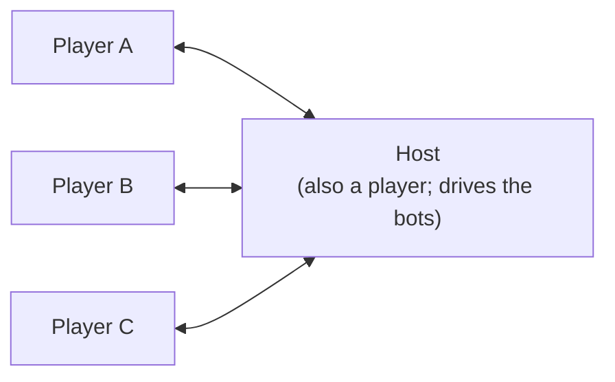
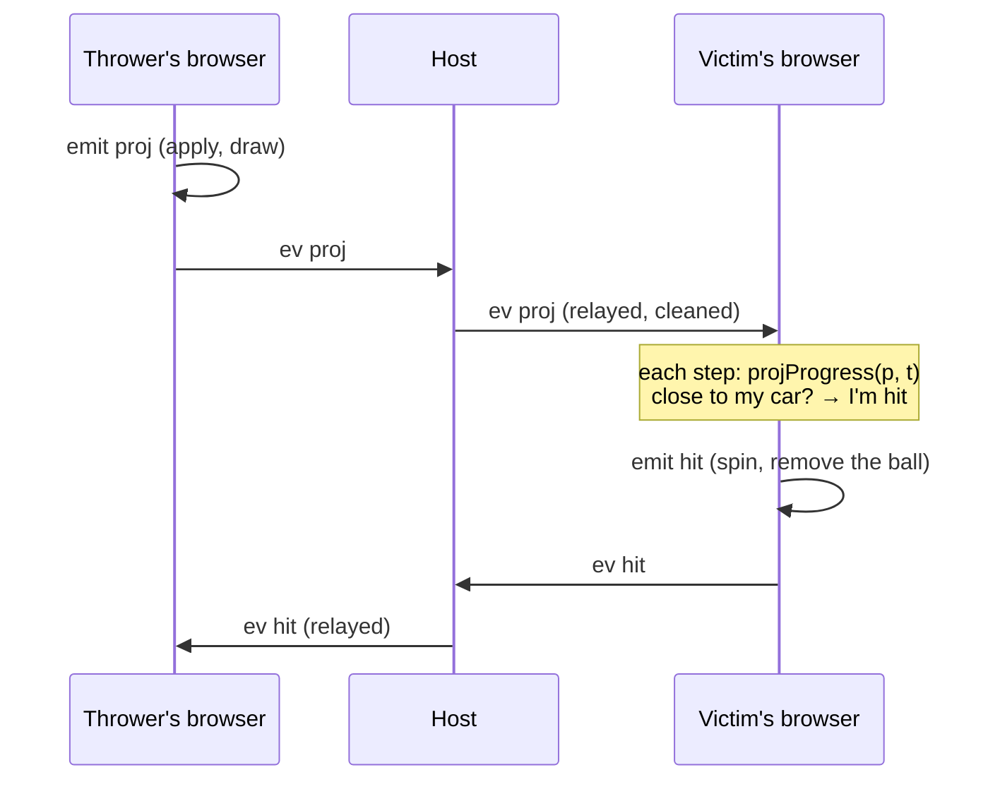

# How Party Kart works

This covers how the pieces fit together: the code's layout, one frame, the simulation, the network,
who decides what, and the rendering. For the game as a player sees it, read the README. For how to
change things, read [making-changes.md](making-changes.md).

## The code

| | | |
|---|---|---|
| `src/math.ts` | sim | A small vector type `V` and its maths, without three.js |
| `braga-map/tracks/amigos.js` | sim | The Volta dos Amigos: Braga's real streets, from the map the games share (the `braga-map` package) |
| `src/track/layout.ts` | sim | The `Point` type; and `LAYOUT`, the first track (the cartoon Braga Grand Prix), kept for reference and for the tests |
| `src/track/track.ts` | sim | `buildTrack`: the road sampled every metre. `locate`: where a point is relative to the road |
| `src/car/car.ts` | sim | `stepCar`: the handling (grip, drift, mini-turbo, boost pads, flying, landing, walls, falling off) |
| `src/car/autopilot.ts` | sim | Drives the track by itself: for the bots, the menu screens, `?autodrive` and the tests |
| `src/race.ts` | sim | Laps, checkpoints, splits, respawning |
| `src/game/arena.ts` | sim | `Arena`: one browser's view of a race. `FLAG`: status bits sent with positions |
| `src/game/racer.ts` | sim | `Racer`: a car this browser drives (laps, boxes, items, hits, bumps, slipstream, catch-up) |
| `src/game/items.ts` | sim | What the items are, the odds by place, the events, where a projectile is at a given time |
| `src/game/bot.ts` | sim | The bots' driving (each on its own line across the road, moving out to pass) and when they use their items |
| `src/session.ts` | browser | Rooms over PeerJS: `HostRoom` and `ClientRoom` |
| `src/main.ts` | browser | The screens, the race loop, the cameras, and the glue between all of it |
| `src/hud.ts` | browser | The race screen: place, lap, item slot, clock, minimap, order, feed |
| `src/stats.ts` | browser | `?stats`: what the game costs on this screen, in a corner, for measuring it on a phone |
| `src/audio.ts` | browser | Every sound and the mix it goes through (buses, a limiter, places): synthesized with Web Audio, but the city's, recorded (`src/sounds/`) |
| `src/ambience.ts` | sim | What's round every 10 m of the track (traffic, town, park, woods) and where the churches, the rivers, the bus stops and the stadium are, from the map, for the city's sound |
| `src/input.ts` | browser | The keyboard and the touch screen: held controls, plus actions counted once per press |
| `src/render/` | browser | three.js: the look, the city round the track (`city.ts`), the road (`road.ts`), the bridges off it, the pillars under its own and the tunnels' mouths (`levels.ts`), the easter eggs, trees, karts and drivers, items, particles, skid marks |

The **sim** files never import three.js or touch the DOM, so `node --test` can load them. The
tests in `test/` drive real cars round the real track with them.

## One frame

`frame()` in `main.ts`, every animation frame. On the menus it laps a few autopilot cars for the
background, or turns your kart on the stage in the lobby. In a race it calls `stepRace`:

1. **`syncOthers`**: for every car this browser doesn't drive, finds the two snapshots either side
   of *now − 110 ms* and interpolates between them. A jump of more than 30 m, such as a respawn,
   snaps instead of sliding. The result goes into `arena.cars` as a `CarInfo` (used for positions,
   bumps and targets) and onto the screen.
2. **Key actions**: horn, camera, use item, respawn, restart.
3. **Fixed steps**: time accumulates, and the car is stepped at `DT = 1/120` s until it catches up
   (at most 0.25 s per frame). Each step sets `arena.t`, the race clock in ms since the green light,
   then steps our `Racer` and the bots' (when hosting). It then writes each one's `info()` into
   `arena.cars`.
4. **`arena.prune()`**: drops projectiles past their lifetime.
5. **Notes**: each `Racer` pushes what happened to it onto `notes`. `ourNotes` turns ours into
   sounds, particles, HUD flashes and `sendLap`/`sendFin`. `botNotes` only reports the bots' laps
   and finishes to the leaderboard.
6. **`sendPos`**: our snapshot, plus the bots' when hosting.
7. **Drawing**: places our kart and the bots', the items (`ItemsView`), the time-attack ghost, the
   countdown and the HUD.

The chase camera comes next, then particles, then `look.render()`.

## The simulation

**The track.** `buildTrack` runs a centripetal Catmull-Rom spline through the layout (`amigos.points`), so sharp corners
don't loop. It then resamples it every metre, starting at the point tagged `start`. Each `Sample`
holds the centre `p`, forward `t`, right `r` (tilted by the banking), surface normal `n`, width,
walls, surface and whether it's a boost pad. Per-stretch settings (`w`, `bank`, `walls`, `surface`)
carry on from point to point until changed. Width and banking blend along each stretch. Each tag is
attached to the sample nearest its point. Checkpoints are the `cp` tags in order, and the start line
follows the last one.

`locate(track, p, hint)` finds the nearest sample, but only searches ±40 samples round `hint`, which
is the car's sample from the step before. That is what stops a road passing over another being
mistaken for it. Without a hint it searches everything.

**The car.** `stepCar` is arcade handling. On the ground, or within a short "coyote" time of leaving
it, it splits the velocity into forward and sideways along the surface. It then applies throttle,
brake, drag and rolling resistance, and bleeds off the sideways part fast with grip, or slowly while
drifting. A drift held with steering charges a mini-turbo: 0.8 s earns level 1, 1.7 s level 2, and
letting go spends it. Gravity always pulls. Where the road falls away faster than the car can drop,
the car flies, and it lands wherever it meets the road again. Walls push back and cost speed. Some time spent off the road and well below it means a respawn. `Mods` scale the
top speed and acceleration, for power-ups and catch-up.

**A lap.** `advance` in `race.ts` checks whether the step from sample `from` to `to` crossed the next
checkpoint, or the line once every checkpoint is done. It returns `cp` or `lap` events with splits
against the best lap. Respawning puts the car back at the last checkpoint, at the speed it went
through.

**A racer.** `Racer.step` works out the input. On the grid it's `stopInput`, which holds the car
still. After the finish the autopilot drives. While spun out it's a gentle `stopInput`. It sets the `Mods`: gold plating, being shrunk, and
catch-up, which in race mode with it on gives up to +7% top speed and +15% pull the further behind
the leader you are. It then steps the car, advances the lap, picks up item boxes and runs the
1.1 s roulette, uses the item, and checks for hits, bumps and slipstream.

`P` is progress: `laps × N + sample`, where `N` is the sample count. Just after the start, a car
still behind the line has a negative `P`. Positions are `arena.order()`: finishers by finish time,
then everyone else by `P`.

**Item boxes are per player.** Every `Racer` keeps its own `taken` map, so a box you take disappears
only for you. It comes back 2.5 s later. What you get depends on your place: `itemOdds` blends from
`FRONT` (pudim, bola, café, guarda-chuva) through `MIDDLE` to `BACK` (três cafés, pombo-correio,
filigrana, foguete, martelinho).

## The network

Everyone connects to the host over WebRTC data channels. PeerJS's free public server only
introduces them, and relays the traffic when a router is strict. The host's peer id is
`partykart-pk30-` plus a five-character room code, and the invite link is `?room=<code>`.

### Messages

To the host (`ToHost` in `session.ts`):

| `t` | | |
|---|---|---|
| `hello` | name, driver | Join. A room with 8 humans already gets `bye` |
| `pick` | driver | Change driver, in the lobby only, if nobody else has it |
| `pos` | `Snap` | Where my car is. Clients send at most 15 a second |
| `lap` | ms | I finished a lap in this time |
| `fin` | ms | I finished the race at this race time |
| `ev` | `ItemEv` | Something I threw or that happened to me |
| `honk` | | |
| `ping` | | Every second. A client silent for 15 s is dropped |

To the clients (`ToClient`):

| `t` | | |
|---|---|---|
| `lobby` | lobby, you | The whole lobby (members, settings, racing or not) and your id in it |
| `cars` | `Snap[]` | Everyone's latest position, 15 times a second during a race |
| `board` | `Entry[]` | The leaderboard: best laps, laps, finish times |
| `start` | goIn, endIn, grid | The race starts in `goIn` ms and ends at the latest in `endIn` ms. `grid` gives each id's slot |
| `end` | `Entry[]` | The results |
| `ev` | `ItemEv` | Someone else's item event, relayed |
| `honk` | id | |
| `bye` | why | You're out: the room is full, or the host has closed it |

`start` gives times relative to when it was sent, so each browser's green light comes late by its
own one-way latency, which is tens of milliseconds. Projectiles and race times carry that skew. At
these speeds it comes to a metre or two, and nothing tries to correct it.

### Item events

An event made in this browser goes through `arena.emit`. That applies it here, then
`arena.send` → `room.sendEv` sends it on. The host broadcasts its own events, and the bots', to
everyone. A client's events go to the host, which cleans them, broadcasts them to everyone else
and applies them itself.

| `k` | Made by | What every browser does |
|---|---|---|
| `proj` | the thrower | Adds a bola, pombo or foguete. Its position at any time is `projProgress(p, t) = p0 + v·(t − t0)` |
| `haz` | the thrower | Adds a pudim at a sample and lateral offset |
| `martelinho` | the user | Each browser's own cars that are ahead of `p0` shrink, unless gold or under a guarda-chuva |
| `hit` | **the victim's browser** | Removes the item, then shows the hit, or the block if `blocked` (a gold car smashing it has `victim: null`) |
| `boom` | the leader the foguete reached | Each browser's own cars within 12 m of it spin too |

The browser of the car that gets hit decides the hit, against the projectile's deterministic
position. So what you see is what happened to you. Nobody sends projectile positions, and a hit
can't be argued with.

### Who decides what

| | |
|---|---|
| Your car's position, laps and finish time | Your browser |
| Whether your car was hit | Your browser |
| The bots: driving, items, laps | The host's browser |
| The lobby: members, drivers, settings, bots | The host |
| The leaderboard and results | The host, from the laps and finishes it's told |
| When the race ends | The host: when everyone's finished, 30 s after the first finisher, or at the time limit (for a race, the laps times the lap limit, plus 60 s; the lap limit is the track's length at 60 km/h, set by `setLapLimit`. For time attack, the chosen minutes) |

This is a game for friends, not a competitive one. A client can lie about its own laps. What the
host does guard against is malformed or hostile input that could break other people's game.
`cleanSnap` and `cleanEv` clamp every number, cut every string short, accept only the known kinds,
and overwrite `owner`/`victim` with the sender's id, so nobody can throw things in someone else's
name. On screen, names only ever go in as text (the `h()` helper in `main.ts`).

Someone joining mid-race is put straight in at the back of the grid. If the host leaves, it sends
everyone a `bye`, the connections close and every client goes back to the home screen. Only a
client's connection to the host ends its room: once in, its socket to PeerJS's server can drop (the
server restarting, a phone changing networks) and the race carries on.

## The two modes

**Race**: 1 to 5 laps from a random starting grid, with positions. Power-ups and catch-up can each
be turned off in the lobby.

**Time attack**: a round of so many minutes, with no items and no catch-up. Your best lap counts.
Backspace restarts the lap. Your browser records each lap every 50 ms, and replays your best one
as a translucent ghost. Other players don't see it. The leaderboard sorts by best lap.

> The README says that in time attack everyone drives "through each other". The code doesn't do
> that: `Racer.contact` runs in both modes, so karts bump and slipstream in time attack too.

## Rendering

- **`Look`** (`render/look.ts`): a golden-hour `Sky` and an environment map made from it, a
  hemisphere light, a sun whose shadow box follows the camera, ACES tone mapping and fog. There are
  three quality levels. High has pixel ratio up to 2 and 2048 shadows. Medium has 1.25 and 1024
  shadows. Low has 1 and no shadows. Changing quality marks every material for recompiling.
- **The city** (`render/city.ts`), from braga-map: `loadWorld(amigos.box)` loads the map's
  500 m tiles under the track's box (48 of them, each a chunk the bundle splits off), and the city
  keeps what's near the road and clears the road itself: buildings within 300 m, none on the road
  or its kerb (nor, for the houses the map filled in, its pavement); trees off the road, those
  filled into parks and woods only within 230 m; the river kept 4.5 m under the road where it
  crosses; and the Tourigalo's bull turned to face the road.
  - The land is the ground as it is (braga-map's, from DGT's LiDAR, every 2 m near the route),
    with the river's bed cut through it and level under the stadium. Its mesh is cells of 10 m
    (20 m on Low), each split into cells of 2 m (4 m on Low) where it needs them: where its two
    triangles would rise through the road or a verge, or, near the road, miss the ground by more
    than 0.5 m (0.8 m on Medium). It keeps a little under the road, its pavements and 3 m past
    them (6 m on Low), so nothing of it shows through, and the verges, strips at the ground's own
    height 6 m wide (12 m on Low) beside each side of the road, are drawn over it there. Further
    off, the whole map's hills every 50 m, coloured by the map's woods and towns and tucked under
    it, and the horizon's hills 15 km round every 250 m (`horizon` in `sights.ts`).
  - What's on the land is painted onto one canvas over the land: the parks, woods and fields,
    water, squares, every other street at its own width with its pavements, the railway. It's 1 m
    a pixel on High,
    1.4 on Medium, 2 on Low. A fine grain, tiled by world position (`onBeforeCompile`), keeps it
    from looking smeared up close.
  - Buildings are their footprints from the map, standing on the ground at their lowest corner
    (`y`, from the map), so a row of houses steps down a hill, and raised to their floors: walls
    textured a floor and two windows at a time and tinted by vertex colour, a ground floor of
    doors and shops on flats, and hipped or gabled roofs over each footprint's rectangle where it
    nearly fills it (flat otherwise). Churches get a tower. They're seven meshes in all, one per material.
  - Then the trees (`plantTrees`, plain crowns in 800 m tiles), the Rio Este and its bridges,
    lamps, zebra crossings, traffic lights and bus stops (`streetFurniture`), a blue-and-white
    plate for each street, brown signs to landmarks, the granite plinth with Braga's arms at the
    start (where the lobby shows your car), and the easter eggs on the friends' houses (`eggs.ts`).
    Neither buildings nor trees stand on the plinth or in an egg's ground.
  - The sights (`sights.ts`): Bom Jesus and its Escadório and the Sameiro on the hills, at twice
    their size so they show from the track; the cross on the Picoto; the Estádio 1.º de Maio with
    its track, terraces, covered stand and floodlights; Makro's and the Altice Forum's signs; and
    the Tourigalo, a black bull with a rooster's head on its lawn, head to the west, five times its
    real size and exaggerated (braga-map's decision 015), its testicles swinging (the one moving
    part, outside the bake), with its restaurant's sign behind; 9 draw calls and about 25,000
    triangles.
- **The road** (`render/road.ts`), the same for any track: the ribbon (asphalt, or granite setts),
  the white lines painted on it as each stretch's `lanes` says, and beyond its edges, as `kerbs`
  says, granite kerbs with calçada pavements behind them, central reservations, or nothing. Each
  side meets the ground as its `edges` (from `city.ts`) say: a pavement slopes from the kerb to
  meet the ground at its back (12% up at most, 5% down), and past that a granite retaining wall
  goes up to the ground where it's higher and a skirt down to it where it's lower; a bridge over a
  road gets a deck. Parapets on the bridges, the barriers at the start, boost pads,
  the start line and gates, string lights (the first track's) and lamps.
- **The first track's world** (`render/world.ts`, with `landmarks.ts`, `braga.ts` and
  `buildTrees`) is kept for reference, and nothing builds it.
- **Few draw calls**: `mat()` shares one material per colour and settings, and `bake()` merges each
  group's static meshes into one mesh per material. Trees, lamps and item boxes are instanced. Particles
  are three pools of one `Points` each: normal, glowing and smoke.
- **Hardly any assets**: every texture is drawn on a canvas in `textures.ts`, and every sound is an
  oscillator or filtered noise in `audio.ts`, but the city's: eight CC0 recordings, 673 KB, in
  `src/sounds/` (braga-map's decision 016). The city's map is numbers in a module, drawn into
  textures and meshes as the game loads.
- **Karts** (`render/drivers.ts`): each `Driver` is one of the friends: a body (`kart`, `trolley`,
  `banger`, `chair`), colours and a second paint (`alt`, for a bot repeating them), extras (on the
  driver and on the car), a trail and a horn. `buildKart` builds the model. Its
  `update(speed, steer, dt, grounded, flags)` animates wheels, steering, tilt, spinning out, the
  shrink and the martelinho's bonk, the filigrana's gold paint, the guarda-chuva, the exhaust
  flames on a boost, and what moves on the car (Vale's clock and hourglass, Capelas's bumper and
  wobbling spare, Pedro's antenna light).
- **Warm-up**: at startup `main.ts` builds every driver's kart once and calls `renderer.compile`,
  so the first race doesn't freeze while shaders compile.

## Sound

Every sound is in `audio.ts`, and plays through one mix. All are synthesized but the city's:

- **The city round the track** is recordings (`src/sounds/`, braga-map's `docs/SOURCES.md` has
  them), fetched once the sound is unlocked, and heard by what's near (`ambienceOf` in
  `src/ambience.ts`, worked out from the map's world once the city is built, 0.2 s here). Four beds
  loop in your head on the ambience bus, re-weighted every half second by what's within 150 m of
  your kart and crossfaded over a second and a half: traffic by the streets' classes and how near,
  the town's hum where there are houses, birds in the parks and gardens, insects and birds where
  it's wooded. The river is heard from its nearest water within 120 m, the crowd from the stadium
  within 400 m, the bells from the nearest church at Braga's hour and half hour and now and then
  as you pass one, and a bus now and then pulling away from a stop you pass.

- **The engines** are a race car's V8 through six gears (`revsFor`): idling at 1,200 rpm, the
  clutch slipping at 5,000 when you pull away, shifting up at 9,000 (the power cut for a moment,
  now and then a pop) and down below 5,200 (the revs blipped), sixth reaching 9,000 at 46 m/s, so
  a boost runs into the limiter. Each kart's engine keeps its own gear. The sound is one wave a
  cycle (two revolutions), its harmonics strongest where a V8 fires, four times a revolution,
  through the exhaust's body, the intake's howl (rising with the revs, loud on the throttle) and a
  low-pass, with the intake's rasp (noise pulsing at the firing rate) under it and the firing never
  quite steady; off the throttle it's darker and crackles on the overrun. Yours is in your head;
  the nearest three others within 150 m (`engines`, from `hearKarts` in `main.ts`) each have one
  through a panner where they are, with the Doppler shift from how fast they and the camera close
  on each other. An engine nobody's is stopped.
- **Your tyres and the wind** are noise, filtered three ways, on the engines' bus: a scrub when the
  tyres slide (drifting, or cornering hard), a rumble on the cobbles shaken at the rate the setts
  go by, and wind rising with speed.

- **Four buses**, each at its level: the engines, the effects, the jingles, and the ambience (the
  city round the track). They meet in a limiter (a
  `DynamicsCompressorNode` at −6 dB, ratio 20, 3 ms), then a trim and the mute, so a foguete going
  off as you're hit on a lap doesn't clip.
- **A jingle ducks the effects** for as long as it plays, so the countdown, a checkpoint, a lap and
  the finish are heard over anything. They're one family: struck bars, in C major.
- **A sound with a place** (others' engines, items, hits and explosions, the eggs, other players'
  honks, the river, the bells, the buses, the crowd) goes
  through a `PannerNode` there, and the listener is on the camera (`listen`, every frame), so it's
  heard from the left or the right, and fainter far away: a twelfth as loud at 120 m, and not
  played past 400 m. Your own racer's sounds have no place: they're in your head.
- **Cheap**: one buffer of noise for every sound that needs some, and at most 24 sounds at once
  (a jingle always plays).
- **Judged by ear**: `?record=60` records the next race's first 60 s, from its countdown, and offers
  them as a file. `node scripts/listen.mjs <label>` records six takes with the autopilot (eight
  karts with items, alone at speed, alone onto the cobbles, and 30 s at three places for the city)
  into `sounds/<day>-<label>/`, with what `__kart.audio` measured of
  each (the loudest sample, the samples clipped, which effects played) and of the loudest sounds
  played at once, and a page setting each take beside the baseline's.

## The city's budget

How much city the game draws, against what the friends' phones are known to run. The floor is an
older Android phone, the slowest one a friend races on. The budget is the city they raced on, per
graphics level: a guide, not a limit (below), and every change that adds to the city measures what
it adds against it. Measure with
`?stats` in a race, `node scripts/shots.mjs <label> --medium` at braga-map's viewpoints, and
`node scripts/download.mjs` (task 004 in braga-map).

**What it costs today** (2026-10-14: party-kart `0c3b077` with `levels.ts`, braga-map 1.6.0, on a
desktop RTX 4060 Ti; the round is `shots/2026-10-14-task012/`. The race of 8 karts is from
2026-10-13, party-kart `ac47bf0` and braga-map 1.2.0, `shots/2026-10-13-budget/`):

| | High | Medium | Low |
|---|---|---|---|
| Pixel ratio, the sun's shadows | 2, 2048 px | 1.25, 1024 px | 1, none |
| The city alone, at the 29 viewpoints: draw calls | 58–184 | 58–184 | 40–165 |
| The city alone: triangles | 0.83–1.14 M | 0.77–0.95 M | 0.48–0.59 M |
| A race of 8 karts, on the start straight: draw calls | 680 | 561 | 456 |
| A race of 8 karts: triangles | 1.22 M | 1.00 M | 0.61 M |
| Textures | 94 MB | 61 MB | 45 MB |
| Building the city | 1.9–2.7 s | 1.7–2.6 s | 1.1–1.7 s |

The download before a race is 5.27 MB as it is, on every level, and `node scripts/download.mjs`
gzips it to 1.56 MB: the game (three.js, PeerJS and the code) is 0.30 MB of that, and the map's 48
tiles 1.25 MB, up from 1.12 MB since braga-map 1.5.0 put in the buildings OpenStreetMap lacks.
GitHub Pages compresses a little less: 1.47 MB live when the script said 1.41. The busiest
viewpoints are `robert-smith` (184 draw calls) and `alameda-fujacal`, `imaculada-conceicao` and
`conselheiro-lobato` (1.14 M triangles on High). braga-map 1.6.0's bridges and tunnels added 6 draw
calls on High and Medium, 3 on Low, and up to 19 k triangles (the decks and mouths about 1.5 k, the
rest the land's small cells round them).

- **Textures**, on High: the ground's painted map is 44 MB (3330 × 2600 pixels, a metre each; 22 MB
  on Medium, 11 on Low), the sun's shadows 16 MB (4 on Medium), the street plates 10.5 MB, the sky's
  reflections 6 MB, and everything else 8 MB. That's counted as the scene holds them (`textureBytes`
  in `src/stats.ts`): four bytes a pixel and a third more for the mipmaps. A canvas texture keeps its
  canvas as well, which Chrome may hold on the graphics card too: the ground's is another 34 MB on
  High.
- **The street plates** are one texture 512 pixels wide and 112 a street, 4032 high for 36 streets.
  The 37th takes it past 4096, the most some phones take.
- **The karts cost more draw calls than the city.** Each is about 40 on Low to 60 on High (its parts
  aren't merged, and are drawn again for the shadows), so 8 karts are two or three times the city.
- **The frame time on the PC** is 0.2–2.6 ms on every level, so it can't tell them apart. Only a
  phone gives the frame rate.
- **Stepping down a level in a race** (`watchSpeed`) changes the pixel ratio and the shadows only.
  The city stays as it was built (`buildCity` runs once), so a phone that starts on Medium and drops
  to Low keeps Medium's triangles and textures.

**The phone wasn't measured** (the owner's call, 2026-10-14), so how much room there is above
today's city isn't known. To find out: `?stats&autodrive` on the slowest phone, on 4G, on Medium
then Low, a race with no bots and then with 7, a whole lap, and `&at=4543` (`robert-smith`).
braga-map's `docs/tasks/done/004-budget.md` has the steps, written for whoever has the phone.

**The budget** is what the city cost when the friends raced on it, rounded up: what their phones
are known to run. It's a guide, not a limit (braga-map's decision 017, which replaced decision
013's "a change may not take the city past it"): every change that adds to the city measures what
it adds against it and says so, but realism comes first, and a change doesn't trim what's real to
stay inside it. braga-map 1.5.0's real buildings took the city past it (0.58 M triangles on Low,
1.56 MB to download). When the city outgrows the friends' phones or GitHub Pages, the game moves to
a stack that scales better, or is served from the owner's homelab.

| The budget, a guide | High | Medium | Low |
|---|---|---|---|
| Draw calls, at any viewpoint | 200 | 200 | 180 |
| Triangles, at any viewpoint | 1.1 M | 0.9 M | 0.55 M |
| Textures | 95 MB | 60 MB | 45 MB |
| Download, as the live site sends it | 1.5 MB | 1.5 MB | 1.5 MB |

These are the city alone, as the shots measure it. The karts, items and effects come on top: about
500 draw calls for 8 karts on High, 370 on Medium, 300 on Low.
