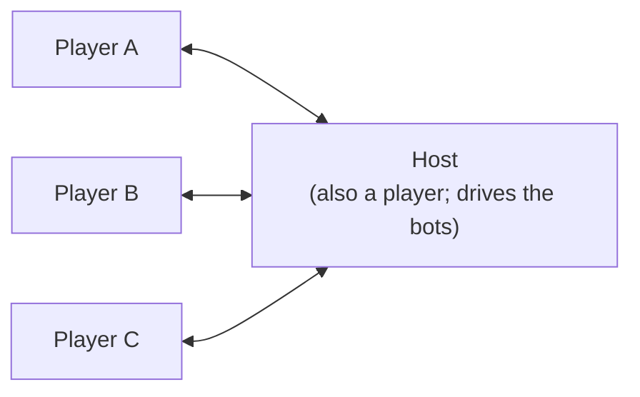
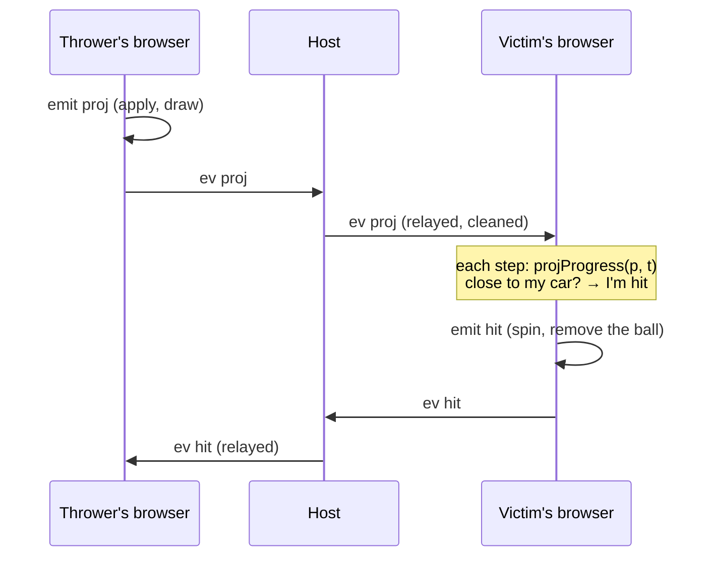

# How Party Kart works

This covers how the pieces fit together: the code's layout, one frame, the simulation, the network,
who decides what, and the rendering. For the game as a player sees it, read the README. For how to
change things, read [making-changes.md](making-changes.md).

## The code

| | | |
|---|---|---|
| `src/math.ts` | sim | A small vector type `V` and its maths, without three.js |
| `src/track/layout.ts` | sim | `LAYOUT`, the hand-placed points of the Braga track with widths, banking, walls, surfaces and tags; the river |
| `src/track/track.ts` | sim | `buildTrack`: the road sampled every metre. `locate`: where a point is relative to the road |
| `src/car/car.ts` | sim | `stepCar`: the handling (grip, drift, mini-turbo, boost pads, flying, landing, walls, falling off) |
| `src/car/autopilot.ts` | sim | Drives the track by itself: for the bots, the menu screens, `?autodrive` and the tests |
| `src/race.ts` | sim | Laps, checkpoints, splits, respawning |
| `src/game/arena.ts` | sim | `Arena`: one browser's view of a race. `FLAG`: status bits sent with positions |
| `src/game/racer.ts` | sim | `Racer`: a car this browser drives (laps, boxes, items, hits, bumps, slipstream, catch-up) |
| `src/game/items.ts` | sim | What the items are, the odds by place, the events, where a projectile is at a given time |
| `src/game/bot.ts` | sim | The bots' driving and when they use their items |
| `src/session.ts` | browser | Rooms over PeerJS: `HostRoom` and `ClientRoom` |
| `src/main.ts` | browser | The screens, the race loop, the cameras, and the glue between all of it |
| `src/hud.ts` | browser | The race screen: place, lap, item slot, clock, minimap, order, feed |
| `src/audio.ts` | browser | Every sound, synthesized with Web Audio |
| `src/input.ts` | browser | The keyboard and the touch screen: held controls, plus actions counted once per press |
| `src/render/` | browser | three.js: the look, the world, Braga, trees, karts and drivers, items, particles, skid marks |

The **sim** files never import three.js or touch the DOM, so `node --test` can load them. The
tests in `test/` drive real cars round the real track with them.

## One frame

`frame()` in `main.ts`, every animation frame. On the menus it laps a few autopilot cars for the
background, or turns your kart on the stage in the lobby. In a race it calls `stepRace`:

1. **`syncOthers`**: for every car this browser doesn't drive, finds the two snapshots either side
   of *now − 110 ms* and interpolates between them. A jump of more than 30 m, such as a respawn,
   snaps instead of sliding. The result goes into `arena.cars` as a `CarInfo` (used for positions,
   bumps and targets) and onto the screen.
2. **Key actions**: horn, camera, use item, respawn, restart.
3. **Fixed steps**: time accumulates, and the car is stepped at `DT = 1/120` s until it catches up
   (at most 0.25 s per frame). Each step sets `arena.t`, the race clock in ms since the green light,
   then steps our `Racer` and the bots' (when hosting). It then writes each one's `info()` into
   `arena.cars`.
4. **`arena.prune()`**: drops projectiles past their lifetime.
5. **Notes**: each `Racer` pushes what happened to it onto `notes`. `ourNotes` turns ours into
   sounds, particles, HUD flashes and `sendLap`/`sendFin`. `botNotes` only reports the bots' laps
   and finishes to the leaderboard.
6. **`sendPos`**: our snapshot, plus the bots' when hosting.
7. **Drawing**: places our kart and the bots', the items (`ItemsView`), the time-attack ghost, the
   countdown and the HUD.

The chase camera comes next, then particles, then `look.render()`.

## The simulation

**The track.** `buildTrack` runs a centripetal Catmull-Rom spline through `LAYOUT`, so sharp corners
don't loop. It then resamples it every metre, starting at the point tagged `start`. Each `Sample`
holds the centre `p`, forward `t`, right `r` (tilted by the banking), surface normal `n`, width,
walls, surface and whether it's a boost pad. Per-stretch settings (`w`, `bank`, `walls`, `surface`)
carry on from point to point until changed. Width and banking blend along each stretch. Each tag is
attached to the sample nearest its point. Checkpoints are the `cp` tags in order, and the start line
follows the last one.

`locate(track, p, hint)` finds the nearest sample, but only searches ±40 samples round `hint`, which
is the car's sample from the step before. That is what stops a road passing over another being
mistaken for it. Without a hint it searches everything.

**The car.** `stepCar` is arcade handling. On the ground, or within a short "coyote" time of leaving
it, it splits the velocity into forward and sideways along the surface. It then applies throttle,
brake, drag and rolling resistance, and bleeds off the sideways part fast with grip, or slowly while
drifting. A drift held with steering charges a mini-turbo: 0.8 s earns level 1, 1.7 s level 2, and
letting go spends it. Gravity always pulls. Where the road falls away faster than the car can drop,
the car flies, and it lands wherever it meets the road again. Walls push back and cost speed. Some time spent off the road and well below it means a respawn. `Mods` scale the
top speed and acceleration, for power-ups and catch-up.

**A lap.** `advance` in `race.ts` checks whether the step from sample `from` to `to` crossed the next
checkpoint, or the line once every checkpoint is done. It returns `cp` or `lap` events with splits
against the best lap. Respawning puts the car back at the last checkpoint, at the speed it went
through.

**A racer.** `Racer.step` works out the input. On the grid it's `stopInput`, which holds the car
still. After the finish the autopilot drives. While spun out it's a gentle `stopInput`. It sets the `Mods`: gold plating, being shrunk, and
catch-up, which in race mode with it on gives up to +7% top speed and +15% pull the further behind
the leader you are. It then steps the car, advances the lap, picks up item boxes and runs the
1.1 s roulette, uses the item, and checks for hits, bumps and slipstream.

`P` is progress: `laps × N + sample`, where `N` is the sample count. Just after the start, a car
still behind the line has a negative `P`. Positions are `arena.order()`: finishers by finish time,
then everyone else by `P`.

**Item boxes are per player.** Every `Racer` keeps its own `taken` map, so a box you take disappears
only for you. It comes back 2.5 s later. What you get depends on your place: `itemOdds` blends from
`FRONT` (pudim, disco, champagne, shield) through `MIDDLE` to `BACK` (triple champagne, drone, gold,
bomb, bass).

## The network

Everyone connects to the host over WebRTC data channels. PeerJS's free public server only
introduces them, and relays the traffic when a router is strict. The host's peer id is
`partykart-pk26-` plus a five-character room code, and the invite link is `?room=<code>`.

### Messages

To the host (`ToHost` in `session.ts`):

| `t` | | |
|---|---|---|
| `hello` | name, driver | Join. A room with 8 humans already gets `bye` |
| `pick` | driver | Change driver, in the lobby only, if nobody else has it |
| `pos` | `Snap` | Where my car is. Clients send at most 15 a second |
| `lap` | ms | I finished a lap in this time |
| `fin` | ms | I finished the race at this race time |
| `ev` | `ItemEv` | Something I threw or that happened to me |
| `honk` | | |
| `ping` | | Every second. A client silent for 15 s is dropped |

To the clients (`ToClient`):

| `t` | | |
|---|---|---|
| `lobby` | lobby, you | The whole lobby (members, settings, racing or not) and your id in it |
| `cars` | `Snap[]` | Everyone's latest position, 15 times a second during a race |
| `board` | `Entry[]` | The leaderboard: best laps, laps, finish times |
| `start` | goIn, endIn, grid | The race starts in `goIn` ms and ends at the latest in `endIn` ms. `grid` gives each id's slot |
| `end` | `Entry[]` | The results |
| `ev` | `ItemEv` | Someone else's item event, relayed |
| `honk` | id | |
| `bye` | why | You're out (the room is full) |

`start` gives times relative to when it was sent, so each browser's green light comes late by its
own one-way latency, which is tens of milliseconds. Projectiles and race times carry that skew. At
these speeds it comes to a metre or two, and nothing tries to correct it.

### Item events

An event made in this browser goes through `arena.emit`. That applies it here, then
`arena.send` → `room.sendEv` sends it on. The host broadcasts its own events, and the bots', to
everyone. A client's events go to the host, which cleans them, broadcasts them to everyone else
and applies them itself.

| `k` | Made by | What every browser does |
|---|---|---|
| `proj` | the thrower | Adds a disco ball, drone or bomb. Its position at any time is `projProgress(p, t) = p0 + v·(t − t0)` |
| `haz` | the thrower | Adds a pudim at a sample and lateral offset |
| `bass` | the user | Each browser's own cars that are ahead of `p0` shrink, unless gold or shielded |
| `hit` | **the victim's browser** | Removes the item, then shows the hit, or the block if `blocked` (a gold car smashing it has `victim: null`) |
| `boom` | the leader the bomb reached | Each browser's own cars within 12 m of it spin too |

The browser of the car that gets hit decides the hit, against the projectile's deterministic
position. So what you see is what happened to you. Nobody sends projectile positions, and a hit
can't be argued with.

### Who decides what

| | |
|---|---|
| Your car's position, laps and finish time | Your browser |
| Whether your car was hit | Your browser |
| The bots: driving, items, laps | The host's browser |
| The lobby: members, drivers, settings, bots | The host |
| The leaderboard and results | The host, from the laps and finishes it's told |
| When the race ends | The host: when everyone's finished, 30 s after the first finisher, or at the time limit (`laps × 150 + 60` s for a race; the chosen minutes for time attack) |

This is a game for friends, not a competitive one. A client can lie about its own laps. What the
host does guard against is malformed or hostile input that could break other people's game.
`cleanSnap` and `cleanEv` clamp every number, cut every string short, accept only the known kinds,
and overwrite `owner`/`victim` with the sender's id, so nobody can throw things in someone else's
name. On screen, names only ever go in as text (the `h()` helper in `main.ts`).

Someone joining mid-race is put straight in at the back of the grid. If the host leaves, the
connections close and every client goes back to the home screen.

## The two modes

**Race**: 1 to 5 laps from a random starting grid, with positions. Power-ups and catch-up can each
be turned off in the lobby.

**Time attack**: a round of so many minutes, with no items and no catch-up. Your best lap counts.
Backspace restarts the lap. Your browser records each lap every 50 ms, and replays your best one
as a translucent ghost. Other players don't see it. The leaderboard sorts by best lap.

> The README says that in time attack everyone drives "through each other". The code doesn't do
> that: `Racer.contact` runs in both modes, so karts bump and slipstream in time attack too.

## Rendering

- **`Look`** (`render/look.ts`): a golden-hour `Sky` and an environment map made from it, a
  hemisphere light, a sun whose shadow box follows the camera, ACES tone mapping and fog. There are
  three quality levels. High has pixel ratio up to 2 and 2048 shadows. Medium has 1.25 and 1024
  shadows. Low has 1 and no shadows. Changing quality marks every material for recompiling.
- **The world** (`render/world.ts`): terrain from `groundHeight`. Near the road that's the road's own
  height, blending further out into the natural hills (Bom Jesus, the Sameiro, Tibães). The river
  bed is cut through it. Then come the road ribbon, kerbs, walls, bridges, boost pads, checkpoint
  gates and lights. `landmarks.ts` and `braga.ts` add the buildings, and `trees.ts` the instanced
  trees.
- **Few draw calls**: `mat()` shares one material per colour and settings, and `bake()` merges each
  landmark's static meshes into one mesh per material. Trees and item boxes are instanced. Particles
  are three pools of one `Points` each: normal, glowing and smoke.
- **No assets**: every texture is drawn on a canvas in `textures.ts`, and every sound is an
  oscillator or filtered noise in `audio.ts`.
- **Karts** (`render/drivers.ts`): each `Driver` is a body (`kart`, `limo`, `stroller`, `vintage`,
  `van`), colours, extras (hats, props), a trail and a horn. `buildKart` builds the model. Its
  `update(speed, steer, dt, grounded, flags)` animates wheels, steering, tilt, spinning out, the
  shrink, gold paint, the shield bubble and the exhaust flames on a boost.
- **Warm-up**: at startup `main.ts` builds every driver's kart once and calls `renderer.compile`,
  so the first race doesn't freeze while shaders compile.
