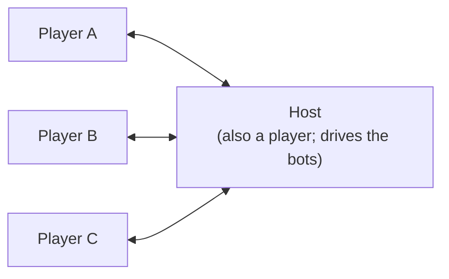
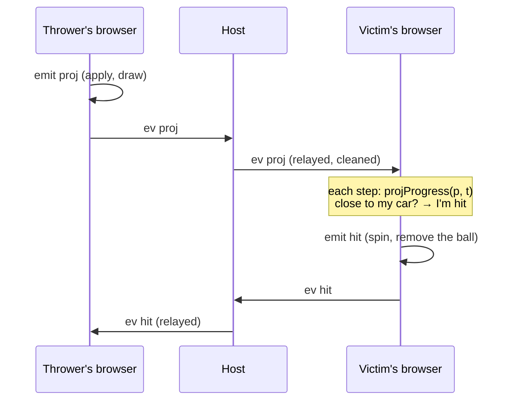

# How Party Kart works

This covers how the pieces fit together: the code's layout, one frame, the simulation, the network,
who decides what, and the rendering. For the game as a player sees it, read the README. For how to
change things, read [making-changes.md](making-changes.md).

## The code

| | | |
|---|---|---|
| `src/math.ts` | sim | A small vector type `V` and its maths, without three.js |
| `src/sun.ts` | sim | Where the sun is over Braga at any moment (NOAA's equations), and `?time=` read in Braga's clock (braga-map's task 022) |
| `braga-map/tracks/amigos.js` | sim | The Volta dos Amigos: Braga's real streets, from the map the games share (the `braga-map` package) |
| `src/track/layout.ts` | sim | The `Point` type; and `LAYOUT`, the first track (the cartoon Braga Grand Prix), kept for reference and for the tests |
| `src/track/track.ts` | sim | `buildTrack`: the road sampled every metre. `locate`: where a point is relative to the road |
| `src/car/car.ts` | sim | `stepCar`: the handling (grip, drift, mini-turbo, boost pads, flying, landing, walls, falling off), on a `Ground`; `trackGround`, a track's own road as one (the first track's, and the tests') |
| `src/world/land.ts` | sim | `makeLand`: the land as it's drawn and driven on (braga-map's ground, held down at the tunnels' mouths, the stadium's bowl, the river's bed); `mouths` |
| `src/world/ground.ts` | sim | `worldGround`: the world as a ground, for the open world: the land, every street and path at its level, each flight of steps a tread at a time, and the walls (buildings, parapets, tunnels, trees, handrails, risers too high to climb, the area's edge); and what the game stands on it (the plinth) |
| `src/world/race.ts` | sim | `raceGround`: the world's ground for a race, with the race's walls (its road's outline, braga-map's `road`), its ramp and the fences where its road drops away; `reachable`, for the tests: whether a race is closed |
| `src/car/autopilot.ts` | sim | Drives the track by itself: for the bots, `?autodrive` and the tests |
| `src/race.ts` | sim | Laps, checkpoints, splits, respawning |
| `src/game/arena.ts` | sim | `Arena`: one browser's view of a race. `FLAG`: status bits sent with positions |
| `src/game/racer.ts` | sim | `Racer`: a car this browser drives (laps, boxes, items, hits, bumps, slipstream, catch-up) |
| `src/game/items.ts` | sim | What the items are, the odds by place, the events, where a projectile is at a given time |
| `src/game/bot.ts` | sim | The bots' driving (each on its own line across the road, moving out to pass) and when they use their items |
| `src/game/roamer.ts` | sim | `Roamer`: your car round the city, outside a race, on the world's ground (bumps and slipstreams, back on the street when lost) |
| `src/game/flyer.ts` | sim | `Flyer`: the flying camera (braga-map's task 054), its pace by its height, kept 1 to 500 m over the ground it's given and inside its bound; `landing`: where your kart is put when you stop flying; `onGrid`: a grid of heights as its triangles are drawn |
| `src/session.ts` | browser | Rooms over PeerJS: `HostRoom` and `ClientRoom` |
| `src/main.ts` | browser | Free roam, the menu over it, the race and its screens, the loop, the cameras, and the glue between all of it |
| `src/hud.ts` | browser | What's on the screen while you drive: in a race (`Hud`: place, lap, item slot, clock, minimap, order, feed), and round the city (`RoamHud`: speed, the street's name, a minimap round you, feed) |
| `src/stats.ts` | browser | `?stats`: what the game costs on this screen, in a corner, for measuring it on a phone |
| `src/audio.ts` | browser | Every sound and the mix it goes through (buses, a limiter, places): synthesized with Web Audio, but the city's, recorded (`src/sounds/`) |
| `src/ambience.ts` | sim | What's round any point of the city on a grid every 10 m (traffic, town, park, woods), each point worked out the first time it's needed, and where the churches, the rivers, the bus stops and the stadium are, from the map, for the city's sound |
| `src/input.ts` | browser | The keyboard, the mouse (a drag looks round while flying) and the touch screen (its layouts for driving and for flying): held controls, plus actions counted once per press |
| `src/render/` | browser | three.js: the look, the city round the track (`city.ts`, its land on `lattice.ts`, what its ground is from `cover.ts`), every street in the open world's area (`streets.ts`, laid on the ground by `tin.ts`), what the race adds to them (`road.ts`), the bridges' pillars and the tunnels' mouths (`levels.ts`), the easter eggs, trees, karts and drivers, items, particles, skid marks |

The **sim** files never import three.js or touch the DOM, so `node --test` can load them. The
tests in `test/` drive real cars round the real track with them.

## One frame

`frame()` in `main.ts`, every animation frame. The game is always one of two things: driving round
the city (free roam, braga-map's decision 019), or a race.

**Round the city** it calls `stepRoam`. The game opens this way, alone, your car where you were when
you last played (kept in `localStorage` every 3 s and as the page goes) or on the plinth at the
start; and goes back to it after a race, where you were before it.

1. **`syncOthers`**, as in a race (below), but for the room's players only: the bots are out only
   in a race. A friend who has just joined is put on the street nearest the host once the host's
   first position comes in (`besideTheHost`).
2. **Key actions**: horn, camera, back on the street, and flying (V, the bar's and the menu's
   buttons: `fly`).
3. **Fixed steps** of `DT`: your `Roamer` on the world's ground (`world.drive`), bumping into the
   others where they're drawn. With a panel open (the menu, the results), or while you fly, it pulls
   up and waits.
4. **Flying** (`r.fly`, braga-map's task 054): the `Flyer` stepped once a frame by your keys, mouse
   and thumbs (`flight`), unless a panel is open.
5. **Notes**: the bumps, slipstreams, mini-turbos, walls and landings, through `feel` as in a race.
6. **`sendPos`**: your snapshot, if you're in a room: parked, while you fly.
7. **Drawing and sound**: your kart (its driver the room's, which gives you another if someone has
   yours), the engines and the city round you (`hearRoam`; flying, your engine from where your kart
   waits and the city from under the camera), the eggs (the track's sample you're by,
   from `locate`, while you're within 8 m of the route's edge), the street's name within 20 m of
   where the route turns into one of its streets, and the `RoamHud` with its minimap (flying, round
   the camera, your kart a dot).

The chase camera follows, or with a panel open the camera turns slowly round your kart (`orbit`),
which stands on the right of the screen, clear of the menu. Flying, the camera is the flyer's
(`flyCam`), held still while a panel is open, and the sun's shadows fall round where it looks on the
ground, at most 100 m ahead (`lookedAt`).

**In a race** it calls `stepRace`:

1. **`syncOthers`**: for every car this browser doesn't drive, finds the two snapshots either side
   of *now − 110 ms* and interpolates between them. A jump of more than 30 m, such as a respawn,
   snaps instead of sliding. The result goes into `arena.cars` as a `CarInfo` (used for positions,
   bumps and targets) and onto the screen.
2. **Key actions**: horn, camera, use item, respawn, restart.
3. **Fixed steps**: time accumulates, and the car is stepped at `DT = 1/120` s until it catches up
   (at most 0.25 s per frame). Each step sets `arena.t`, the race clock in ms since the green light,
   then steps our `Racer` and the bots' (when hosting). It then writes each one's `info()` into
   `arena.cars`.
4. **`arena.prune()`**: drops projectiles past their lifetime.
5. **Notes**: each `Racer` pushes what happened to it onto `notes`. `ourNotes` turns ours into
   sounds, particles, HUD flashes and `sendLap`/`sendFin`. `botNotes` only reports the bots' laps
   and finishes to the leaderboard.
6. **`sendPos`**: our snapshot, plus the bots' when hosting.
7. **Drawing**: places our kart and the bots', the items (`ItemsView`), the time-attack ghost, the
   countdown and the HUD.

The chase camera comes next, then particles, then `look.render()`.

## The simulation

**The track.** `buildTrack` runs a centripetal Catmull-Rom spline through the layout (`amigos.points`), so sharp corners
don't loop. It then resamples it every metre, starting at the point tagged `start`. Each `Sample`
holds the centre `p`, forward `t`, right `r` (tilted by the banking), surface normal `n`, width,
walls, surface and whether it's a boost pad. Per-stretch settings (`w`, `bank`, `walls`, `surface`)
carry on from point to point until changed. Width and banking blend along each stretch. Each tag is
attached to the sample nearest its point. Checkpoints are the `cp` tags in order, and the start line
follows the last one.

`locate(track, p, hint)` finds the nearest sample, but only searches ±40 samples round `hint`, which
is the car's sample from the step before. That is what stops a road passing over another being
mistaken for it. Without a hint it searches everything.

**The car.** `stepCar` is arcade handling. On the ground, or within a short "coyote" time of leaving
it, it splits the velocity into forward and sideways along the surface. It then applies throttle,
brake, drag and rolling resistance, and bleeds off the sideways part fast with grip, or slowly while
drifting. A drift held with steering charges a mini-turbo: 0.8 s earns level 1, 1.7 s level 2, and
letting go spends it. Gravity always pulls. Where the road falls away faster than the car can drop,
the car flies, and it lands wherever it meets the road again. Walls push back and cost speed. Some time spent off the road and well below it means a respawn. `Mods` scale the
top speed and acceleration, for power-ups and catch-up.

**The ground.** What the car drives on is a `Ground` (`car.ts`): `under` gives the surface's normal
and whether it's a boost pad before the car moves, and `contact`, after it moves, stands it on its
surface (`settle`, which holds it to anything within 5 cm, so it hugs the road) or lets it fly
(`fly`), pushes it out of walls (`bounce`), and says whether it has fallen off. The handling is the
same on any ground. A track's own, `trackGround(track)`, is the first track's and the tests': the
car is on the road within its width and not far under it, walls stand at its edges, and `locate`
keeps its sample (`idx`) and how far right of the centre line it is (`lat`). In a ramp's flight
(`air` samples, braga-map's `ramps`: the jump over the Rio Este into the dead end, task 039) there's
no road and no walls: the car flies on to the landing, and one 3 m under the flight's line has fallen
short. `track.ramps` has its foot, lip and landing by sample, and `rampSpeed` how fast to take it.
The race on the Volta dos Amigos runs on the world's (below), with the race's walls and ramp.

The open world's (braga-map's decision 019) is `worldGround(world, open?)` in `src/world/ground.ts`,
built once (about 0.2 s for the Volta dos Amigos' area) from braga-map's `loadWorld`. Everything
in it is looked up in a grid of 10 m cells, so a step costs the same anywhere: eight cars take about
40 µs a step on a desktop, timed in `test/ground.test.ts`.

- **The floor.** At a point the candidates are the land (`land.ts`'s, as drawn), a pavement a kerb
  (15 cm) over it, sloping down to a kerb dropped at a crossing, a footway, path or cycleway on it
  (braga-map's task 050; a kerb over it where it runs in a pavement, flush with it), a flight of
  steps' tread at its own height in the land's place, and every street or path piece off the
  ground over the point at its height: a bridge's deck, a footbridge's, a tunnel's road (braga-map's
  `world.streets`). The car stands on the highest no more than a step (`STEP`, 0.3 m) over its
  wheels, looked for from where it was if it was higher, so it lands however hard it comes down: on
  a deck it's on the deck, under it it's on the street below, in a tunnel the land over it is its
  roof. Streets stand on the land without the river's bed cut into it (`firm`), so one beside the
  river, or crossing it at the ground's level, keeps its height. A piece's height inside is its
  outline's nearest edges', and where it meets the land at grade it's eased to the land's height
  over 10 m (the map's deck ends can be 0.4 m off the ground's). A ground pavement that runs onto a
  piece's road gives way to it. The normal is the surface's over 3 m, about a car's length, so the
  2 m ground doesn't shake the car, and a flight of steps is a slope it climbs a riser at a time. Off
  a piece, where a deck's or a tunnel's road is nearer the car's height than the land under it, the
  normal takes that road's height there: else a car just off a deck's end takes the embankment under
  the deck for the land's slope, and at speed is thrown up off it (braga-map's task 026).
- **The walls** are 2D segments, each standing from a foot to a top, so a car flies over one it's
  above and passes under one it's below: every building's outline, trimmed at the kerb where it
  stands on a carriageway (the map's street too wide or its line off the middle, until braga-map's
  task 026), which leaves a passage through one open; a deck's parapets and a tunnel's sides, wherever
  a piece's edge has neither more street nor the land at its own level beside it (a tunnel's
  no higher than 3 m, so a street over it stays clear); the concrete of the tunnels' mouths; the
  trees' trunks, but those on a carriageway; the steps' handrails, from the treads to their top; a
  riser more than a step high, a step short of its tread (a flight the map counts too few steps for:
  59 of 3,091 between treads, and 234 of a tread's 420 edges over a street or a path beside it);
  every wall, fence, railing, hedge and gate braga-map has (its task 013; a gate shut, whatever it
  says, which is for someone on foot), from under the ground to its top, a hedge or anything half a
  metre thick along both its sides, and a retaining wall 0.6 m over its top (`HOLD`: the land under
  it is a 2 m grid's, which ramps up to it, and would launch a kart over it at speed);
  and, given the area (`open`, braga-map's task 032), its edge at every level and a barrier across
  each street and path leaving it. A building is trimmed at a path's passage under it as at a
  carriageway (the owner's answer to braga-map's task 050), so it's open too. The car is two circles, 1.6 m
  across and 1.9 m apart, pushed out of what they're in a few times over, and back the way it came
  if it went through a wall in one step. The land is a wall where it would rise more than a step in
  front of the car, or off the carriageway or a path steeper than 35°. A car going up a kerb hops
  (it flies until it comes down) and loses 12% of its speed across the kerb; so up each riser of a
  flight of steps, and down one it drops to the tread below.
- **Lost:** a car in the land, in the river, wedged between walls or out of the world counts towards
  a respawn, and `spawn` puts it on the nearest street's carriageway at its level (in a tunnel,
  in the tunnel), facing along the street. A car never turns over in this handling.
- **What the game stands on it:** `stand(pts, y)` adds a flat block a car stands on and drives off,
  its sides walls a step short of its top (the plinth at the start, free roam's first spot, with
  `wall()` for the wall at its back); and `unwall(ring)` takes away the walls of a building the city
  leaves out to keep clear round the plinth, an egg or the Tourigalo, so there's no wall where
  nothing is drawn. `surface(x, z, y)` says whether the street or path under a car is cobbled, for
  the tyres' rumble round the city.
- **For a race** (braga-map's task 037), `raceGround` (`src/world/race.ts`) makes `ground.race(track,
  walls, ramps, road)`: the same world, sharing what was built, keeping each car's `idx` and `lat`
  along the track, and adding what only the race has. Its walls are the race's road's outline
  (braga-map's `road`: the route's own streets at their real widths, as they're drawn, and the
  jump's flight, on past its landing as far as a kart flat out comes down), in pieces up to 2 m long, each standing from 1.5 m under the road beside it to 3 m
  over it, at the route's level (on a deck, the deck; under the jump's flight, the floor beside the
  edge, the river's bed or the Ecovia on its bank): every kerb along the route, and across each
  side street, and between a road's two carriageways drawn as one, where braga-map's `closures` say
  a row of barriers is drawn. In front of a tunnel's mouth, where the land is held down and the
  route's street runs by it, a fence stands where the road drops more than 1.5 m under the route
  (`raceDips`: 7 m at the Avenida da Liberdade's underpass, a few metres at the Avenida João XXI's).
  The ramp is a slope a car stands on (`floor`'s `ramp`), from the street at its foot to its lip,
  its sides walls a step short of its planks; its boost pads give a boost as wide as they're drawn.
  A car that comes down on what's under a ramp's flight, or 3 m under the flight's line, has fallen
  short; one that comes down off the race's road (launched over a wall) has left the race: both are
  lost, and `respawn` puts them back (on the jump's run-up, at
  the speed that clears it). A car the race makes on the track (the grid, a respawn) is put on what's
  under it (`place`). `reachable` floods the race's road from its line, a metre at a time, for the
  tests: nothing off it is reachable. Built with the city (`world.race`), in about 60 ms.

**A lap.** `advance` in `race.ts` checks whether the step from sample `from` to `to` crossed the next
checkpoint, or the line once every checkpoint is done. It returns `cp` or `lap` events with splits
against the best lap. Respawning puts the car back at the last checkpoint, at the speed it went
through; or, when it fell at a jump (`jumpAt`), 50 m back on its run-up at `rampSpeed`. The
autopilot takes a ramp at `rampSpeed` and the bots drink no café near one, or they overshoot its
landing.

**A racer.** `Racer.step` works out the input. On the grid it's `stopInput`, which holds the car
still. After the finish the autopilot drives. While spun out it's a gentle `stopInput`. It sets the `Mods`: gold plating, being shrunk, and
catch-up, which in race mode with it on gives up to +7% top speed and +15% pull the further behind
the leader you are. It then steps the car, advances the lap, picks up item boxes and runs the
1.1 s roulette, uses the item, and checks for hits, bumps and slipstream.

`P` is progress: `laps × N + sample`, where `N` is the sample count. Just after the start, a car
still behind the line has a negative `P`. Positions are `arena.order()`: finishers by finish time,
then everyone else by `P`.

**Item boxes are per player.** Every `Racer` keeps its own `taken` map, so a box you take disappears
only for you. It comes back 2.5 s later. What you get depends on your place: `itemOdds` blends from
`FRONT` (pudim, bola, café, guarda-chuva) through `MIDDLE` to `BACK` (três cafés, pombo-correio,
filigrana, foguete, martelinho).

## The network

Everyone connects to the host over WebRTC data channels. PeerJS's free public server only
introduces them, and relays the traffic when a router is strict. The host's peer id is
`partykart-pk35-` plus a five-character room code, and the invite link is `?room=<code>`, which
opens the game straight into the room. A room is made only when someone invites friends ("Convidar
amigos") or starts a race; until then the game is alone, with no network at all.

### Messages

To the host (`ToHost` in `session.ts`):

| `t` | | |
|---|---|---|
| `hello` | name, driver | Join. A room with 8 humans already gets `bye` |
| `pick` | driver | Change driver, outside a race, if nobody else has it |
| `name` | name | Change my name, outside a race |
| `pos` | `Snap` | Where my car is. Clients send at most 15 a second |
| `lap` | ms | I finished a lap in this time |
| `fin` | ms | I finished the race at this race time |
| `ev` | `ItemEv` | Something I threw or that happened to me |
| `honk` | | |
| `ping` | | Every second. A client silent for 15 s is dropped |

To the clients (`ToClient`):

| `t` | | |
|---|---|---|
| `lobby` | lobby, you | The whole room (members, the race's settings, racing or not) and your id in it |
| `cars` | `Snap[]` | Everyone's latest position, 15 times a second, round the city as in a race |
| `board` | `Entry[]` | The leaderboard: best laps, laps, finish times |
| `start` | goIn, endIn, grid | The race starts in `goIn` ms and ends at the latest in `endIn` ms. `grid` gives each id's slot |
| `end` | `Entry[]` | The results |
| `ev` | `ItemEv` | Someone else's item event, relayed |
| `honk` | id | |
| `bye` | why | You're out: the room is full, or the host has closed it |

`start` gives times relative to when it was sent, so each browser's green light comes late by its
own one-way latency, which is tens of milliseconds. Projectiles and race times carry that skew. At
these speeds it comes to a metre or two, and nothing tries to correct it.

### Item events

An event made in this browser goes through `arena.emit`. That applies it here, then
`arena.send` → `room.sendEv` sends it on. The host broadcasts its own events, and the bots', to
everyone. A client's events go to the host, which cleans them, broadcasts them to everyone else
and applies them itself.

| `k` | Made by | What every browser does |
|---|---|---|
| `proj` | the thrower | Adds a bola, pombo or foguete. Its position at any time is `projProgress(p, t) = p0 + v·(t − t0)` |
| `haz` | the thrower | Adds a pudim at a sample and lateral offset |
| `martelinho` | the user | Each browser's own cars that are ahead of `p0` shrink, unless gold or under a guarda-chuva |
| `hit` | **the victim's browser** | Removes the item, then shows the hit, or the block if `blocked` (a gold car smashing it has `victim: null`) |
| `boom` | the leader the foguete reached | Each browser's own cars within 12 m of it spin too |

The browser of the car that gets hit decides the hit, against the projectile's deterministic
position. So what you see is what happened to you. Nobody sends projectile positions, and a hit
can't be argued with.

### Who decides what

| | |
|---|---|
| Your car's position, laps and finish time | Your browser |
| Whether your car was hit | Your browser |
| The bots: driving, items, laps | The host's browser |
| The room: members, names, drivers, the race's settings, bots | The host |
| The leaderboard and results | The host, from the laps and finishes it's told |
| When the race ends | The host: when everyone's finished, 30 s after the first finisher, or at the time limit (for a race, the laps times the lap limit, plus 60 s; the lap limit is the track's length at 60 km/h, set by `setLapLimit`. For time attack, the chosen minutes) |

This is a game for friends, not a competitive one. A client can lie about its own laps. What the
host does guard against is malformed or hostile input that could break other people's game.
`cleanSnap` and `cleanEv` clamp every number, cut every string short, accept only the known kinds,
and overwrite `owner`/`victim` with the sender's id, so nobody can throw things in someone else's
name. On screen, names only ever go in as text (the `h()` helper in `main.ts`).

Someone joining mid-race is put straight in at the back of the grid. When a race ends the host
drops the bots' positions, and everyone the race's: round the city only the players are out. If the
host leaves, it sends everyone a `bye`, the connections close, and every client drives on alone,
where it is (the feed says so). Only a
client's connection to the host ends its room: once in, its socket to PeerJS's server can drop (the
server restarting, a phone changing networks) and the race carries on.

## The modes

**Free roam**: the game outside a race. No laps, items or catch-up; karts bump and slipstream as in
a race. The menu's "Corrida" gives the host the race's settings, and starting it takes everyone in
the room (braga-map's decision 019).

**Flying** (braga-map's task 054), in free roam: your kart waits where it is, sending its snapshot,
and the camera flies (`Flyer`, `src/game/flyer.ts`): 6 m/s at a person's height, rising to 80 m/s
from 80 m up, four times that with Shift, easing in and out in about 0.15 s. It keeps 1 m over what's
drawn (`world.above`: the city's ground in the box, the hills every 50 m round it and the horizon's
every 250 m, each as its triangles are drawn) and climbs no higher than 500 m over it, through
buildings and trees; and it flies as far as the horizon (`world.horizon`, the hills 15 km round), short
of their end by 6 km, where the haze hides it (`HAZED`). Stopping puts your kart on the street
nearest the point under the camera, at the level under it (`landing`, from the area's nearest point
when the camera is outside it, facing into the area); the others see it jump, as after a respawn. A
race the host starts ends the flight, and you're back in your kart where it waited when it's over.
The sky goes with the camera (`Look.render`), as it's a box 20 km across.

**Race**: 1 to 3 laps from a random starting grid, with positions. Power-ups and catch-up can each
be turned off in the race's settings.

**Time attack**: a round of so many minutes, with no items and no catch-up. Your best lap counts.
Backspace restarts the lap. Your browser records each lap every 50 ms, and replays your best one
as a translucent ghost. Other players don't see it. The leaderboard sorts by best lap.

> The README says that in time attack everyone drives "through each other". The code doesn't do
> that: `Racer.contact` runs in both modes, so karts bump and slipstream in time attack too.

## Rendering

- **`Look`** (`render/look.ts`, braga-map's task 022): Braga's light at a moment of the day, by default the clear
  March afternoon of the photos of the Rua do Fujacal (`DEFAULT_TIME`), or `?time=`'s; the sun where `sun.ts` puts
  it, its colour what's left of it through the air (Preetham's extinction, as the sky's shader has it). Matched to
  the photos: the sun about four times the sky's light, as a shadow in them is a quarter as bright as the sunlit
  ground beside it; a clear sky's deep blue overhead (turbidity 2), with three's procedural clouds made a fair day's
  cumulus (six octaves of noise, a sharper edge) that drift with the game's clock; and a haze that thickens with the
  distance, not its square (`fog_fragment` changed once for every material), blue-grey, hiding about half of a hill
  4 km off. `?weather=grey` is a grey Minho day: the sky an overcast (the sky's shader's colour replaced),
  the sun faint, the sky's light stronger, the haze thicker, and the streets' surfaces and paint darker and glossy
  (`WET`, in `streets.ts`); `?weather=rain` adds the rain, 10,000 streaks in a box 40 m across that goes with the
  camera, each worked out on the graphics card from the clock (one draw call). The street lamps light and glow only
  once the sun is under 4° (`LIT`); by day a lamp is its post, its arm and a pale grey head. A `Sky` (a box 20 km across that goes with the camera,
  so the flying camera never leaves it) and an environment map made from it, a
  hemisphere light, a sun whose shadow box follows the camera, ACES tone mapping and fog. There are
  three quality levels. High has pixel ratio up to 2 and 2048 shadows. Medium has 1.25 and 1024
  shadows. Low has 1 and no shadows. Changing quality marks every material for recompiling.
- **The city** (`render/city.ts`), from braga-map: `loadWorld(amigos.box)` loads the map's
  500 m tiles under the track's box (48 of them, each a chunk the bundle splits off), and makes the
  world the karts' ground of it (`worldGround`, `src/world/ground.ts`, kept as the city's `drive`
  for driving on). It keeps what's in the open world's area and 300 m round it: every building, cut
  back at the kerb where it stands on a carriageway as the karts find it (`trimmed`, braga-map's
  decision 021); in the area every tree the karts can hit (all but those on a carriageway), and
  round it the map's own and those filled into parks and woods within 230 m, every 2nd on Medium
  and every 3rd on Low; and the Tourigalo's bull turned to face the road.
  - The land is the ground as the karts have it (`land.ts`: braga-map's, from DGT's LiDAR, every
    2 m in the area), with the river's bed cut through it and level under the stadium. Its mesh is
    on a lattice (`lattice.ts`) of cells of 10 m (20 m on Low), each split into cells of 2 m (4 m on
    Low) where it needs them: near a tunnel's mouth or under a deck, and where the land shows beside
    a street (not under it, nor under a building) and its two triangles would miss the ground there
    by more than 0.8 m (1 m on Medium, 1.2 on Low). It's drawn a square kilometre at a time. Under
    the streets it isn't drawn at all: the painting is left clear there, 0.6 pixels in from their
    outline, and the land's material skips what's clear, whatever the land's height, so it never
    shows through a street. Further off, the whole map's hills every 50 m, coloured by the map's
    woods and towns and tucked under it, and the horizon's hills 15 km round every 250 m (`horizon`
    in `sights.ts`).
  - What the ground is, where braga-map has classed it (its task 016, decision 034: every tile
    under the Volta dos Amigos' box, which the city loads), is drawn in the land's shader
    (`groundMaterial`, with `cover.ts`): each 50 cm cell's kind (asphalt, paving, setts, grass, bare
    soil, gravel, water, a roof) in its own seamless photo (CC0, from Poly Haven), tiled at its real
    size, its own mean colour divided out and the place's put in: that kind's colour over the tile,
    the orthophoto's without its cars and shadows. A cell's kind blends into its neighbours' over
    half its width; under a tree's crown the ground is 15% darker, and from 40 m off to 160 m a
    crown's cells turn the green of the game's trees (the orthophoto's canopy reads slate-blue under
    the game's light). The orthophoto's blue haze is taken out, and its brightness eased (`TONE`: as
    it comes, its sunlit asphalt is a light grey). The classes are packed two cells a byte, a layer
    a tile of one array texture, the colours a layer a tile and kind of another; a tile the open
    world's area doesn't touch loads its classes at Low's 2 m, drawn at the level's cells all the
    same. With every tile under the land classed, the canvas below is only a mask of where the
    streets are, a byte a pixel, and its canvas is let go.
  - Where the ground isn't classed (or the cover can't load), what's on the land is painted onto one
    canvas over the land: the parks, woods and fields, water, squares, car parks, and beyond the
    open world's tiles every street at its own width with its pavements, and the railway; an area's
    holes (a clearing in a wood) left out. It's 1 m a pixel on High, 1.4 on Medium, 2 on Low,
    uploaded with its colours times their share of what's clear, so the land's edge at a street
    isn't darkened. A fine grain, tiled by world position (`onBeforeCompile`), keeps it from looking
    smeared up close.
  - Buildings are their footprints from the map, standing on the ground at their lowest corner
    (`y`, from the map), so a row of houses steps down a hill, and raised to their floors, with
    hipped or gabled roofs over each footprint's rectangle where it nearly fills it (flat otherwise;
    cut to it when the building's been cut at the kerb). Their walls are their facades as the map
    says they are (braga-map's task 017, `render/facades.ts`): the kind's bay (a window and the wall
    round it, a storey high, drawn on a canvas in metres in the kind's proportions,
    `map().facadeTypes`) repeated along each wall and up it, the ground floor below the first
    storey's line as it is along a street (shops, garages, an arcade, glass; else the storeys' own,
    or plain wall behind a building with shops), over the walls' material tiled at its real size
    (render, small tiles, mosaic, azulejos, granite, stone slabs, brick, concrete, blocks, glass,
    metal sheets, panels); the bay's alpha says what each pixel is, so one shader tints the wall with
    the building's colour, the ground floor with its base's and the roller shutters with theirs. The
    walls (and the photo facades) take a third of the sky's reflections everything else takes
    (`WALL_SKY`, in their shader: three.js gives a material the scene's environment at the scene's
    intensity whatever its own says), as the hemisphere light lights them from the sky already and the
    two together washed every colour to a bluish white (a teal (58, 118, 118) came out (189, 228,
    229)). A
    wall faces a street if one of the map's streets is within 7 m of a point 4 m out from its middle.
    The balconies are geometry, on the walls along a street within 60 m of the open world (High; in it
    on Medium, none on Low): a slab
    and a railing (bars on a clear texture) under every other bay's window, the wall's length, glazed
    in, or a railing across the window. Churches the LiDAR didn't see get a tower. They're four meshes
    a square kilometre (walls, roofs, railings), so the sun's shadows draw only the squares near the
    camera. The shops' signs (`render/signs.ts`, the map's `world.signs`) are a fascia in the sign's
    colour and the name in letters cut from one canvas of every letter they use: two meshes.
  - Then the trees (`plantTrees`, plain crowns in 800 m tiles, plainer still on Low), the Rio Este,
    the decks' pillars and abutments and the tunnels' mouths (`levels.ts`), brown signs to
    landmarks on the pavement, the granite plinth with Braga's arms at the start (free roam's first
    spot: its top is a block the karts stand on, `stand` in `ground.ts`), and the easter eggs on the friends' houses (`eggs.ts`). Neither buildings nor
    trees stand on the plinth or in an egg's ground.
- **The streets** (`render/streets.ts`): every street in the open world's area as braga-map gives
  it (`world.streets`, its task 033), on the ground the karts drive on (`ground.ts`): a carriageway
  on the land without the river's bed cut into it (`firm`), a pavement, a central reservation or an
  island a kerb over it (15 cm, sloping down to a kerb dropped at a crossing), a deck's or a
  tunnel's road at its height. Each piece is triangulated (three.js's earcut, its outline cut into
  pieces of at most 10 m on High) and its edges halved where the ground under them bends by more
  than 25 cm (50 on a pavement; coarser on Medium and Low; `tin.ts`). Whether an edge is halved
  depends on that edge alone, so the pieces either side of it meet at the same points, without
  cracks. The carriageways drawn are 3.4 cm off the ground the karts stand on at the median, and
  19 cm at the 90th percentile (`test/streets.test.ts`). Asphalt, setts, calçada, grass on a wide
  reservation or an island, each texture's rows along the nearest street's line.
  - Every footway, path, cycleway and flight of steps (braga-map's task 050, `world.streets.paths`):
    in calçada, paving stones, setts, asphalt, concrete, gravel or earth as the map says, a
    cycleway's asphalt red (`textures.ts`'s `paving`, `cycleway` and `gravel` are three more layers
    of the streets' texture); a path on the land as a carriageway is, one flush with a pavement a
    kerb over it, with the kerb's face where it meets a cycle lane; each tread flat at its height,
    with a face down to what's beside it where that's lower (the riser, between two treads) and a
    granite wall up to the land where that's higher; a steel handrail on posts every 1.5 m where
    the map has one; a footbridge's deck and its parapets as a bridge's, but a wooden one's (the
    Picoto's boardwalk, braga-map's task 021) its boards (`planks`, one more layer), a board along
    its edge and a timber rail on posts every 1.5 m down to the ground.
  - The walls, fences, railings, hedges and gates (braga-map's task 013, `world.walls`), each on the
    ground the karts drive on (`ground.ts`'s `wallSpan`, every 3 m along it on High, 4 on Medium,
    6 on Low): a wall a block in what it's made of (granite blocks, render painted near white, a
    weathered cement: `textures.ts`'s `wallBlocks`, `plaster` and `hedge` are three more layers of
    the streets' texture, and `cement` the plaster tinted), with on High a coping stone on it, and a
    railing its top half where braga-map has one on it; a retaining wall's face from its foot to its
    top (its back, in the higher ground, isn't drawn); a hedge a block of leaves; a fence's wire mesh,
    a railing's and a gate's bars see-through (alpha-tested, two materials for all of them), on steel
    posts; a guard rail a steel band, a lift gate a red bar. Where one of the map's retaining walls
    stands along a street's edge, it's drawn in the place of the granite wall below.
  - A granite kerb wherever a pavement meets a carriageway: its face, and on High its stones' tops.
    Where a street's outline meets the land, a skirt down to it, or a granite retaining wall up to
    it where the land stands more than 12 cm over the edge (25 on Low), and on High a granite step
    at a pavement's back; none against a building, nor where one of the map's retaining walls stands. The decks' undersides, and their parapets and
    the tunnels' sides where the karts meet them (`ground.ts`'s `sides`). Within an arch's reach
    (São João da Ponte's bridge, braga-map's `arch` sight, task 021) a deck is granite: its parapets
    dressed stone, and under them the arch's faces down to the ground, its opening over the river and
    the paths beside it (`archOf`), on no pillars (`levels.ts` leaves them out).
  - The lines painted on the carriageways as they're drawn: lanes and middles, dashed or solid,
    zebras (their bars on one grid of a metre, so crossings the map has side by side line up),
    stop lines.
  - Lamps on every pavement wide enough, half a metre behind the kerb, about one every 30 m down a
    street; a traffic light at each stop line's kerb end, facing the cars stopping; the route's bus
    stops and street plates at the kerb nearest them (braga-map's tiles have no names or stops
    yet: its task 042); and a row of red-and-white road-works barriers with "Estrada cortada"
    across every street and path where it leaves the area (braga-map's gates, its task 032).
  - The surfaces and faces are one mesh a tile (500 m), their textures layers of one array
    texture (`tuv`: each vertex's uv and layer); the paint another.
  - The sights (`sights.ts`): Bom Jesus and its Escadório and the Sameiro on the hills, at twice
    their size so they show from the track; the Picoto's white steel cross, with its ring, on a
    granite block; São João da Ponte's chapel (`chapel.ts`, braga-map's task 021), drawn in its
    building's place (the building's still a wall to the karts); the route's other chapels, Santa
    Justa's, Santo Adrião's and Santa Tecla's, the Igreja de São Lázaro's bell tower and the
    shrines of the Senhor do Bonfim and the Senhor da Boa Morte (`chapels.ts`, braga-map's task
    056), each from its photos at the size and heights braga-map gives it, in its buildings' place
    as São João's is (any sight with `covers`), and baked together into a mesh a material, a draw
    call each wherever any of them is in view (the shrines, which the tiles leave out, aren't walls
    to the karts); the Estádio 1.º de Maio
    (`stadium.ts`), its stands as braga-map measured them along spokes round the track, stepped a
    metre a step, its outer wall, the main stand's roof and its four floodlights where the LiDAR
    saw them; Makro's sign; the Altice Forum's α; and the Tourigalo, a black bull with a rooster's head on its lawn, head to the west, five times its
    real size and exaggerated (braga-map's decision 015), its testicles swinging (the one moving
    part, outside the bake), with its restaurant's sign behind; 42 meshes and about 62,000
    triangles, drawn whole wherever they're in view (9 and 25,000 before braga-map's task 021).
- **The road** (`render/road.ts`): what the race adds to the streets (`raceMarks`): the start
  line, the gates at the start and the checkpoints, the boost pads, the barriers at the start and in
  rows across the side streets (braga-map's `closures`, and the fences where the race's road drops
  away), and the ramp, laid on the streets as they're drawn at the route's level. They're the city's
  `marks`, up only while a race is on (`startRace`, `endRace`): round the city, and in `?scenery`,
  the streets are as they are. `buildRoad` draws the first track's road (its ribbon, lines, kerbs,
  pavements and skirts), which had no streets under it.
- **The first track's world** (`render/world.ts`, with `landmarks.ts`, `braga.ts` and
  `buildTrees`) is kept for reference, and nothing builds it.
- **Few draw calls**: `mat()` shares one material per colour and settings, and `bake()` merges each
  group's static meshes into one mesh per material. Trees, lamps and item boxes are instanced. Particles
  are three pools of one `Points` each: normal, glowing and smoke.
- **Hardly any assets of its own**: every texture the game makes is drawn on a canvas in
  `textures.ts`, and every sound is an oscillator or filtered noise in `audio.ts`, but the city's:
  eight CC0 recordings, 673 KB, in `src/sounds/` (braga-map's decision 016). The city's map is
  numbers in a module, drawn into textures and meshes as the game loads.
- **Photo textures** are the map's, not the game's (braga-map's decisions 002 and 030): KTX2 files
  in braga-map's `world/textures/`, one for each graphics level, which `loadWorld` lists with
  each tile (`world.photos`) and Vite serves as assets (never inlined, `vite.config.ts`).
  `render/photos.ts` loads them with three.js's KTX2Loader, which turns Basis Universal's ETC1S
  into what the graphics card takes (ETC1 on a phone, BC7 on a PC) in its workers, so they stay
  compressed on the card: half a byte a pixel on a phone, a byte on a PC, where a canvas or a WebP
  takes four. The kinds of ground's photos are drawn always (braga-map's task 016, above), so the
  loader and Basis's transcoder (0.56 MB, 0.26 MB gzipped) come with the city. The facades are
  drawn always (braga-map's task 017), each as quads 4 cm in front of its wall, a mesh each, in its
  building's colour: the photo times that colour over the wall's colour in the photo (each in linear
  light, as the map gives them), so a photo at dusk or through a tinted windscreen is as bright and
  as white as the walls round it.
- **Karts** (`render/drivers.ts`): each `Driver` is one of the friends: a body (`kart`, `trolley`,
  `banger`, `chair`), colours and a second paint (`alt`, for a bot repeating them), extras (on the
  driver and on the car), a trail and a horn. `buildKart` builds the model. Its
  `update(speed, steer, dt, grounded, flags)` animates wheels, steering, tilt, spinning out, the
  shrink and the martelinho's bonk, the filigrana's gold paint, the guarda-chuva, the exhaust
  flames on a boost, and what moves on the car (Vale's clock and hourglass, Capelas's bumper and
  wobbling spare, Pedro's antenna light).
- **Warm-up**: at startup `main.ts` builds every driver's kart once and calls `renderer.compile`
  with the race's marks up, so neither a friend joining nor the first race freezes while shaders
  compile.

## Sound

Every sound is in `audio.ts`, and plays through one mix. All are synthesized but the city's:

- **The city round you** is recordings (`src/sounds/`, braga-map's `docs/SOURCES.md` has
  them), fetched once the sound is unlocked, and heard by what's near your kart, wherever it is
  (`ambienceOf` in `src/ambience.ts`, from the map the karts drive on, once the city is built: a grid
  every 10 m over the world, each point worked out the first time a kart comes near it, about a
  quarter of a millisecond each, and what's between them blended from the four round it). Four beds
  loop in your head on the ambience bus, re-weighted every half second by what's within 150 m of
  your kart and crossfaded over a second and a half: traffic by the streets' classes and how near,
  the town's hum where there are houses, birds in the parks and gardens, insects and birds where
  it's wooded. The river is heard from its nearest water within 120 m, the crowd from the stadium
  within 400 m, the bells from the nearest church at Braga's hour and half hour and now and then
  as you pass one, and a bus now and then pulling away from a stop you pass.

- **The engines** are a race car's V8 through six gears (`revsFor`): idling at 1,200 rpm, the
  clutch slipping at 5,000 when you pull away, shifting up at 9,000 (the power cut for a moment,
  now and then a pop) and down below 5,200 (the revs blipped), sixth reaching 9,000 at 46 m/s, so
  a boost runs into the limiter. Each kart's engine keeps its own gear. The sound is one wave a
  cycle (two revolutions), its harmonics strongest where a V8 fires, four times a revolution,
  through the exhaust's body, the intake's howl (rising with the revs, loud on the throttle) and a
  low-pass, with the intake's rasp (noise pulsing at the firing rate) under it and the firing never
  quite steady; off the throttle it's darker and crackles on the overrun. Yours is in your head;
  the nearest three others within 150 m (`engines`, from `hearKarts` in `main.ts`) each have one
  through a panner where they are, with the Doppler shift from how fast they and the camera close
  on each other. An engine nobody's is stopped.
- **Your tyres and the wind** are noise, filtered three ways, on the engines' bus: a scrub when the
  tyres slide (drifting, or cornering hard), a rumble on the cobbles shaken at the rate the setts
  go by, and wind rising with speed.

- **Four buses**, each at its level: the engines, the effects, the jingles, and the ambience (the
  city round the track). They meet in a limiter (a
  `DynamicsCompressorNode` at −6 dB, ratio 20, 3 ms), then a trim and the mute, so a foguete going
  off as you're hit on a lap doesn't clip.
- **A jingle ducks the effects** for as long as it plays, so the countdown, a checkpoint, a lap and
  the finish are heard over anything. They're one family: struck bars, in C major.
- **A sound with a place** (others' engines, items, hits and explosions, the eggs, other players'
  honks, the river, the bells, the buses, the crowd) goes
  through a `PannerNode` there, and the listener is on the camera (`listen`, every frame), so it's
  heard from the left or the right, and fainter far away: a twelfth as loud at 120 m, and not
  played past 400 m. Your own racer's sounds have no place: they're in your head.
- **Cheap**: one buffer of noise for every sound that needs some, and at most 24 sounds at once
  (a jingle always plays).
- **Judged by ear**: `?record=60` records the next race's first 60 s, from its countdown, and offers
  them as a file. `node scripts/listen.mjs <label>` records six takes with the autopilot (eight
  karts with items, alone at speed, alone onto the cobbles, and 30 s at three places for the city)
  into `sounds/<day>-<label>/`, with what `__kart.audio` measured of
  each (the loudest sample, the samples clipped, which effects played) and of the loudest sounds
  played at once, and a page setting each take beside the baseline's.

## The city's budget

How much city the game draws, against what the friends' phones are known to run. The floor is an
older Android phone, the slowest one a friend races on. The budget is the city they raced on, per
graphics level: a guide, not a limit (below), and every change that adds to the city measures what
it adds against it. Measure with
`?stats` in a race, `node scripts/shots.mjs <label> --medium` at braga-map's viewpoints, and
`node scripts/download.mjs` (task 004 in braga-map).

**What it costs today** (2026-10-15: party-kart with every street in the area drawn, braga-map's
task 035, on braga-map 1.7.0, on a desktop RTX 4060 Ti; the round is `shots/2026-10-15-task035/`.
The race of 8 karts is from 2026-10-13, party-kart `ac47bf0` and braga-map 1.2.0,
`shots/2026-10-13-budget/`, before the streets):

| | High | Medium | Low |
|---|---|---|---|
| Pixel ratio, the sun's shadows | 2, 2048 px | 1.25, 1024 px | 1, none |
| The city alone, at the 29 viewpoints: draw calls | 58–226 | 58–226 | 39–207 |
| The city alone: triangles | 0.40–1.57 M | 0.38–1.31 M | 0.25–0.88 M |
| A race of 8 karts, on the start straight: draw calls | 680 | 561 | 456 |
| A race of 8 karts: triangles | 1.22 M | 1.00 M | 0.61 M |
| Textures | 91 MB | 57 MB | 42 MB |
| Building the city | 3.8–5.3 s | 2.9–4.9 s | 2.6–4.5 s |

**What every street in the area cost** (task 035, against `shots/2026-10-14-task012/`, the same 29
viewpoints): before it, the city was 58–184 draw calls on High and Medium and 40–165 on Low,
0.83–1.14 M triangles on High, 0.77–0.95 M on Medium and 0.48–0.59 M on Low, 94, 61 and 45 MB of
textures, and built in 1.9–2.7 s on High, 1.7–2.6 on Medium and 1.1–1.7 on Low. The busiest
viewpoints are still `robert-smith`, `alameda-fujacal`, `conselheiro-lobato` and
`imaculada-conceicao`: about 40 more draw calls each and 0.4 M more triangles on High (0.3 M on
Low), where the streets, the land beside them and the buildings round the whole area are in view.
The quietest got cheaper (0.40 M on High where it was 0.83 M): what's drawn is cut into tiles, so
what's out of view isn't drawn, where the track's road and its land were always drawn whole. Over
the whole box, on High, the streets are 0.70 M triangles (their surfaces 0.31 M, the granite of
the kerbs, steps and walls 0.19 M, the rest the paint, the skirts, the decks and what stands along
them), the land 0.38 M, the trees 0.28 M and the buildings 0.20 M; on Low, 0.45, 0.17, 0.10 and
0.20 M. Textures went down by 3 MB: the streets' and the buildings' textures are layers of three
arrays. Building the city takes about twice as long, the streets about 1.4 s of it on the desktop (two
rounds an hour apart differed by up to 0.9 s, the desktop busy with other work): a phone, three to
five times slower, would wait 10–20 s. The download grew by 0.01 MB, the code.
The download before a race is 5.27 MB as it is, on every level, and `node scripts/download.mjs`
gzips it to 1.56 MB: the game (three.js, PeerJS and the code) is 0.30 MB of that, and the map's 48
tiles 1.25 MB, up from 1.12 MB since braga-map 1.5.0 put in the buildings OpenStreetMap lacks.
GitHub Pages compresses a little less: 1.47 MB live when the script said 1.41. The busiest
viewpoints are `robert-smith` (184 draw calls) and `alameda-fujacal`, `imaculada-conceicao` and
`conselheiro-lobato` (1.14 M triangles on High). braga-map 1.6.0's bridges and tunnels added 6 draw
calls on High and Medium, 3 on Low, and up to 19 k triangles (the decks and mouths about 1.5 k, the
rest the land's small cells round them). braga-map 1.7.0 (2026-10-14, for the open world's ground,
its task 034) takes the download to 6.79 MB, 2.07 MB gzipped (the tiles 1.75 MB): every street as
surfaces and the ground every 2 m under the open world's area, which the game draws since task 035
and drives on from task 036. Task 035's code takes it to 6.81 MB, 2.08 MB gzipped, and free roam's
(task 036) to 6.83 MB, 2.08 MB gzipped, measured since then on the page as a player opens it, until
the loading screen goes and you can drive. Free roam took 3 to 16 draw calls off every viewpoint
(`shots/2026-10-15-task036/`): the race's marks, one mesh along the whole route, are up only in a
race. braga-map's tasks 039 and 047 (the jump into the dead end, the open world grown by Ponte
Pedrinha round the loop's new stretch, and the decks at the LiDAR's height) take the download to
7.24 MB, 2.19 MB gzipped (the tiles 1.85 MB), as the track's box grew 330 m west; against
`shots/2026-10-15-mundo-aberto/` (`shots/2026-10-15-rampa/`), from 3 fewer to 17 more draw calls
a viewpoint, `robert-smith` the most at 227 on High and 209 on Low, up to 0.16 M more triangles
(1.73 M on High, 0.98 M on Low, there too), textures 97 MB on High and 45 on Low (91 and 42: the
ground's painted map is bigger), and the city built in 2.8 s on High where it took 2.6. The ramp
is about 10 draw calls and a few hundred triangles, in a race only. braga-map's task 037 (the race
on the streets at their real widths) takes the download to 7.30 MB, 2.21 MB gzipped: the track's
race road and its rows of barriers, 36 KB more in the track's file. Round the city nothing changes
(`shots/2026-10-15-task037/` against `rampa`: the same draw calls but 2 at `fujacal-start`, where
the plinth moved with the start line, and within 3,000 triangles everywhere, the city built in
3.0–3.2 s on High on a busier desktop). In a race its 188 rows of barriers are about 1,000
triangles and no draw call more (they share the start's barriers' material, baked into one mesh),
and its ground's 10,000 wall pieces take about 60 ms to build with the city. braga-map 1.12.0's
photo textures (its task 007) cost nothing without `?photos`: 0.01 MB more to download (2.22 MB
gzipped), the tiles' indexes of them. With it (`shots/2026-10-15-task007-photos/` against
`task037`): up to 10 more draw calls where facades are in view (`robert-smith` 237 on High, 219 on
Low), a few dozen triangles, textures 105 MB on High and 63 on Medium as the PC holds them (97 and
61 before; on a phone, which takes them as ETC1, half the difference: +4 and +1 MB), 45 on Low
either way, the city built about 0.25 s slower, and 1.4 MB more to download on High (0.4 on
Medium, 0.13 on Low) besides Basis's transcoder, 0.26 MB gzipped, once. braga-map's footways,
paths, cycleways and steps (its task 050; `shots/2026-10-15-after050/` against
`shots/2026-10-15-before050/`) take 0 to 3 more draw calls a viewpoint and 45–172 k more
triangles on High (the median 87 k, `robert-smith` the most at 1.90 M), 30–127 k on Low (1.10 M
there), no texture memory to speak of (three more 256-pixel layers of the streets' texture), and
build the city 0.5–0.9 s slower on High (4.9–5.8 s); the download is 7.58 MB, 2.33 MB gzipped,
the tiles 0.11 MB more. braga-map's walls, fences, railings, hedges and gates (its task 013;
`shots/2026-10-16-after013/` against `after050`, on braga-map installed from the folder) take 3 to
6 more draw calls a viewpoint (74–233 on High) and 131–559 k more triangles on High (the median
305 k: 0.71–2.46 M where 0.58–1.90 M, `robert-smith` the most, then `conselheiro-lobato` and
`alameda-fujacal`), 96–264 k on Medium (the median 163 k) and 56–208 k on Low (0.41–1.31 M), 1 MB
more texture memory (four more 256-pixel layers of the streets' texture, two small see-through
ones), and the city built no slower (3.6–3.9 s on High, the desktop less busy than for 050); a frame
0.3–2.2 ms. The tiles are 0.27 MB more gzipped (the open world's 53, 2.11 to 2.38 MB). Most of the
triangles are the 80 km of retaining walls round the area, 59 of them found by the LiDAR.
braga-map's ground as it is (its task 016, on braga-map 1.16.0; `shots/2026-10-16-after016/`
against `after013`) takes no draw call and no triangle more (113 calls and 1.37 M triangles on High
at the median, 89 and 0.74 M on Low), textures 98 → 118 MB on High, 62 → 68 on Medium and 45 → 42
on Low as the PC holds them: the classes 24 MB on High (6 on Medium, 1.5 on Low), the kinds'
colours 27 MB (17, 4), the six photos 8.4 MB as BC7 (a phone's ETC1 half that), and the painted
map's 51 MB given back for a 12.7 MB mask. The city builds as fast as it did with 013 (4.2 s on High
at the median; against `after050`, the painting it no longer does took 1.3 s off). The download on
High is 7.24 MB gzipped (13.25 MB as is), about 4.6 MB more: the ground's classes 2.0 MB (a tile outside
the open world's area at Low's 2 m), its colours 0.95, the six photos 1.3, Basis's transcoder 0.25;
about 2.4 MB more on Medium and 1.2 on Low, from the files' sizes. Loading only the tiles near the
player would bring it down (braga-map's task 038). braga-map's streets without slivers (its task 048, on 1.17.1;
`shots/2026-10-16-after048/` against `after016`) take no draw call more and no texture: 4 k more
triangles on High at the median (1.37 M), 6 k on Low, the most at `robert-smith` (11 k), from the
carriageways' points the snap rounding puts in and the scraps they keep (the carriageways laid in
the race's box, 215 k → 227 k on High). Laying them takes 6 ms more (155 against 149), and the
city builds as fast: shot side by side on 1.16.0 and 1.17.0 that afternoon, 5.9–6.5 s on High
either way, the desktop busier than for `after016` (4.2 s).

braga-map's facades (its task 017; `shots/2026-10-16-task017/`, shot before it was merged with 048,
against `after016`, the median of the 29 viewpoints): draw calls 113 → 126 on High and Medium, 89 → 95 on
Low (the ten photo facades where they're in view, a mesh each, now drawn for everyone; the signs' two
meshes; the railings' one a square kilometre); triangles 1.37 → 1.66 M on High, 1.10 → 1.37 on
Medium, 0.74 → 0.76 on Low (the balconies; the most, at `alameda-fujacal`, 2.46 → 2.85 M);
textures 118 → 132 MB on High, 68 → 80 on Medium, 42 → 47 on Low (the kit's two arrays, 5.6 and 4.2
MB with their mipmaps, a quarter of that on Low, and the ten photos). A frame takes 0.4–2.7 ms on
every level. The city builds in 6.6 s on High at the median against 4.2 (4.4 against 3.8 on Medium,
3.7 against 3.9 on Low): the buildings 0.8 s of it, the kit 0.1, the photos' wait 0.5. The download
on High is 7.96 MB gzipped (14.25 as is), 0.72 MB more: the facades' photos, now fetched always,
and the tiles 0.15 MB more gzipped over the open world's 53 (each building's facade, the signs).
Shot again after the merge with 048, on braga-map 1.18.0 (`shots/2026-10-16-after017/`, party-kart
`ad9814e`, against `after048`): the same, 113 → 126 calls, 1.37 → 1.67 M triangles and 118 → 132 MB
of textures on High at the median (89 → 95, 0.74 → 0.76 M and 42 → 47 MB on Low); the most
triangles at `conselheiro-lobato`, 2.17 → 2.62 M on High. The city built in 4.7 s on High, 4.9 on
Medium and 4.2 on Low, a frame 0.7–1.1 ms.

braga-map's corners cut back at the decks' and tunnels' ends (its task 046, on 1.18.1;
`shots/2026-10-16-after046/`, shot on `d49612c` with braga-map installed from its checkout, against
`after017`): the same, 126 calls, 1.67 M triangles and 132 MB of textures on High at the median (95,
0.76 M and 47 MB on Low), no viewpoint more than about a thousand triangles off. The city built in
5.3 s on High, 4.8 on Medium and 4.2 on Low, a frame 0.6–0.8 ms.

braga-map's light (its task 022; `shots/2026-10-17-after022/`, shot on `909539b`, braga-map 1.18.1,
against `after046`): the same 126 calls on High and Medium and 95 on Low at the median (each viewpoint
within 6, as the sun's new direction puts other things in its shadow box), 1.67 → 1.76 M triangles on
High and 0.76 → 0.79 M on Low (the street lamps' arms, and the shadows), the same textures. The sky's
clouds cost 0.15–0.17 ms a frame at 1920 × 1080 on the desktop, against a sky without them (three
viewpoints, alternated); the round's frame times (0.8–1.2 ms at the median) and build times (6.8 s on
High) were taken with other sessions busy on the desktop. `?weather=rain` adds one draw call.

braga-map's landmarks along the route (its task 021, on 1.19.0; `shots/2026-10-17-after021/`,
party-kart `a86355b` with 054's flying camera merged in but not 022's light, against `after046`, at the median of the 29
viewpoints both shot): the sights are 42 meshes and 61,900 triangles where they were 9 and about
25,000 (São João da Ponte's chapel in nine materials, the stadium's stands, wall, roof, track and
floodlights in seven). Draw calls 126 → 132 on High and Medium (up to 15 more where the chapel and
the arch's side of the city are in view: `sao-joao-da-ponte`, `liberdade`), 95 → 96 on Low;
triangles 1.67 → 1.71 M on High, 1.38 → 1.42 on Medium, 0.76 → 0.79 on Low (41 k more everywhere,
as the sights are drawn whole, and 63 k at `estadio`); textures 132 → 133 MB on High, 80 → 81 on
Medium, 47 → 48 on Low (the stadium's wall and the α, two canvases). The city built in 6.5 s on
High against 5.3 (6.0 against 4.8 on Medium, 5.1 against 4.2 on Low), with 054's camera in it too;
a frame 0.7–1.4 ms. The three new viewpoints: `capela-sao-joao` 146 calls and 1.69 M triangles on
High, `altice-forum` 197 and 2.43 M, `picoto-top` 200 and 2.16 M (105, 163 and 169 calls on Low).
The download on High is 7.99 MB gzipped (14.32 as is), 0.03 MB more: the code, and braga-map's base
with the stadium's stands (5,100 heights).

braga-map's streets on their real carriageways (its task 026, on 1.20.1; `shots/2026-10-17-after026/`,
party-kart `fd4dc07`, with 022's light and 021's landmarks both in it): against `after021` and
`after022`, the mean of the 29 viewpoints all three shot, what's left after the light (0.05 M
triangles more on High, 0.03 on Low) and the landmarks (0.02 M) is about 0.01 M triangles on High
and Low, 0.6%: the streets measured wider and their edges where the LiDAR has them. One draw call
more, the same textures. Over the 32 viewpoints, 81–269 draw calls and 0.91–2.95 M triangles on
High, 81–268 and 0.81–2.30 M on Medium, 54–237 and 0.46–1.42 M on Low; the city built in 5.9–7.0 s
on High, 4.1–5.5 on Low. The download on High is 8.04 MB gzipped (14.42 as is), 0.05 MB more, the
tiles.

- **Textures**, on High (118 MB): what the ground is 60 MB (its classes 24 MB, its kinds' colours
  27, their six photos 8.4 as BC7) and the streets' mask 12.7 MB (a byte a pixel, a metre each),
  where the ground's painted map was 51 MB before task 016; the sun's shadows 16 MB (4 on Medium),
  the street plates 10.5 MB, the sky's reflections 6 MB, and everything else the rest (the
  streets' textures among it, as one array). That's counted as the scene holds them (`textureBytes`
  in `src/stats.ts`): its bytes a pixel and a third more for the mipmaps. A canvas texture keeps its
  canvas as well, which Chrome may hold on the graphics card too: the painted map's, where there is
  one, may take as much again; the mask's is let go.
- **The street plates** are one texture 512 pixels wide and 112 a street, 4032 high for 36 streets.
  The 37th takes it past 4096, the most some phones take.
- **The karts cost more draw calls than the city.** Each is about 40 on Low to 60 on High (its parts
  aren't merged, and are drawn again for the shadows), so 8 karts are two or three times the city.
- **The frame time on the PC** is 0.4–2.6 ms on every level, so it can't tell them apart. Only a
  phone gives the frame rate.
- **Stepping down a level** (`watchSpeed`, round the city or in a race) changes the pixel ratio and the shadows only.
  The city stays as it was built (`buildCity` runs once), so a phone that starts on Medium and drops
  to Low keeps Medium's triangles and textures.

**The phone wasn't measured** (the owner's call, 2026-10-14), so how much room there is above
today's city isn't known. To find out: `?stats&autodrive` on the slowest phone, on 4G, on Medium
then Low, a race with no bots and then with 7, a whole lap, and `&at=4543` (`robert-smith`).
braga-map's `docs/tasks/done/004-budget.md` has the steps, written for whoever has the phone.

**The budget** is what the city cost when the friends raced on it, rounded up: what their phones
are known to run. It's a guide, not a limit (braga-map's decision 017, which replaced decision
013's "a change may not take the city past it"): every change that adds to the city measures what
it adds against it and says so, but realism comes first, and a change doesn't trim what's real to
stay inside it. braga-map 1.5.0's real buildings took the city past it (0.58 M triangles on Low,
1.56 MB to download). When the city outgrows the friends' phones or GitHub Pages, the game moves to
a stack that scales better, or is served from the owner's homelab.

| The budget, a guide | High | Medium | Low |
|---|---|---|---|
| Draw calls, at any viewpoint | 200 | 200 | 180 |
| Triangles, at any viewpoint | 1.1 M | 0.9 M | 0.55 M |
| Textures | 95 MB | 60 MB | 45 MB |
| Download, as the live site sends it | 1.5 MB | 1.5 MB | 1.5 MB |

These are the city alone, as the shots measure it. The karts, items and effects come on top: about
500 draw calls for 8 karts on High, 370 on Medium, 300 on Low.
